[← Volver al laboratorio](../README.md)

# 02 · GPO: BitLocker y bloqueo de NTLM


Segunda práctica del laboratorio. Sobre el dominio creado en la [práctica 01](../01-active-directory), se usan **directivas de grupo (GPO)** para desplegar el cifrado con **BitLocker** (con desbloqueo por PIN y copia de las claves de recuperación en Active Directory) y para **restringir el protocolo NTLM** en todo el dominio.

## Objetivos

| Punto | Descripción |
|:--:|---|
| **A** | Crear una GPO para desplegar BitLocker y habilitar el cifrado de disco. Configurar el desbloqueo por PIN y habilitar que las claves de recuperación de los equipos cifrados se guarden en Active Directory |
| **B** | Implementar una GPO que bloquee NTLM y desplegarla a los equipos del dominio |

> [!NOTE]
> **Alcance de la demostración.** La GPO define las políticas de inicio con PIN, TPM y recuperación en Active Directory. La demostración práctica del cifrado se realizó sobre una **partición nueva (`E:`)** creada en el servidor, con desbloqueo por contraseña.

## Entorno

| Elemento | Valor |
|---|---|
| Hipervisor | VMware Workstation Pro 17 |
| Servidor (controlador de dominio) | Windows Server 2022, `Neury0829` |
| Dominio | `Neury0829.local` |
| GPO creadas | `GPO BitLocker` y `GPO NTLM`, ambas vinculadas al dominio |

## Requisitos previos

- Práctica 01 completada: dominio de Active Directory funcionando.
- Sesión iniciada con un usuario administrador del dominio.

## Índice

- [Parte A: BitLocker mediante GPO](#parte-a-bitlocker-mediante-gpo)
- [Parte B: Bloqueo de NTLM mediante GPO](#parte-b-bloqueo-de-ntlm-mediante-gpo)
- [Verificación final](#verificación-final)
- [Solución de problemas](#solución-de-problemas-frecuentes)

---

## Parte A: BitLocker mediante GPO

Antes de iniciar, nos encontramos en el Administrador del servidor.

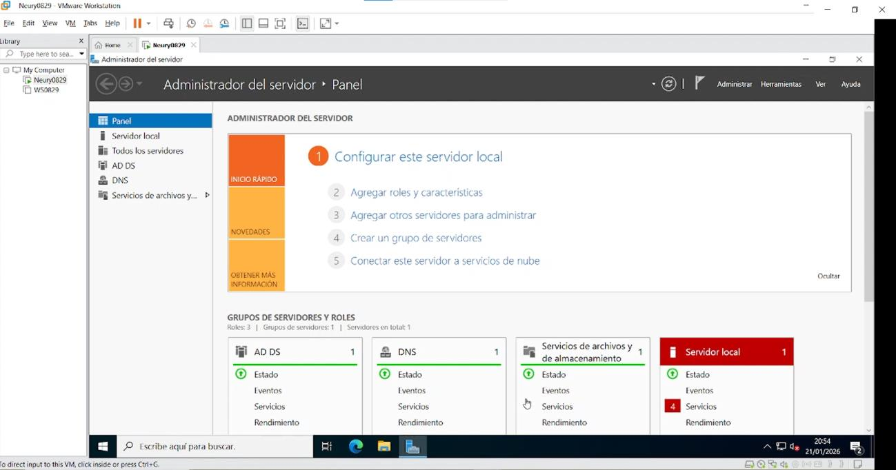


### Instalar la característica BitLocker

**1.** Hacemos clic en **Administrar** y luego en **Agregar roles y características**.

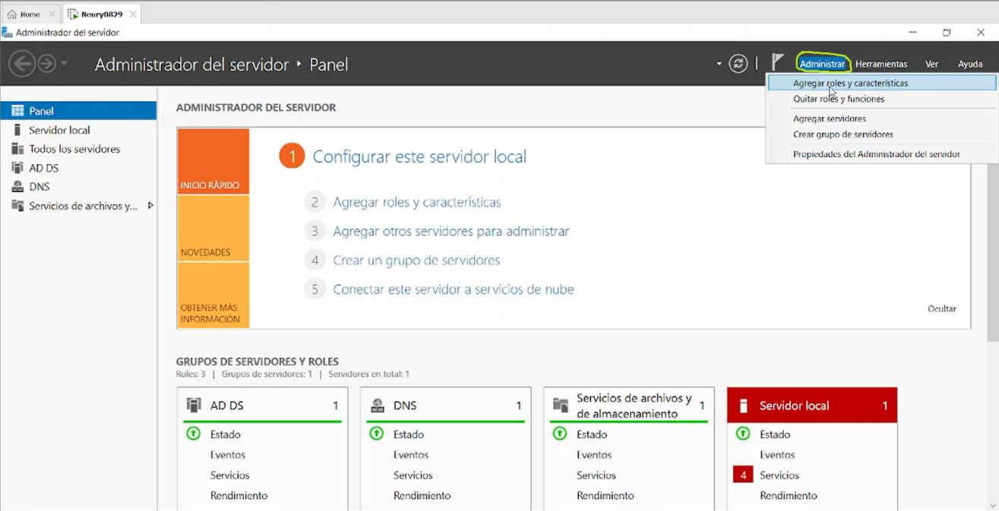


**2.** Se abre el asistente. Hacemos clic en **Siguiente** hasta llegar a la pantalla de **características** y seleccionamos **Cifrado de unidad BitLocker**.

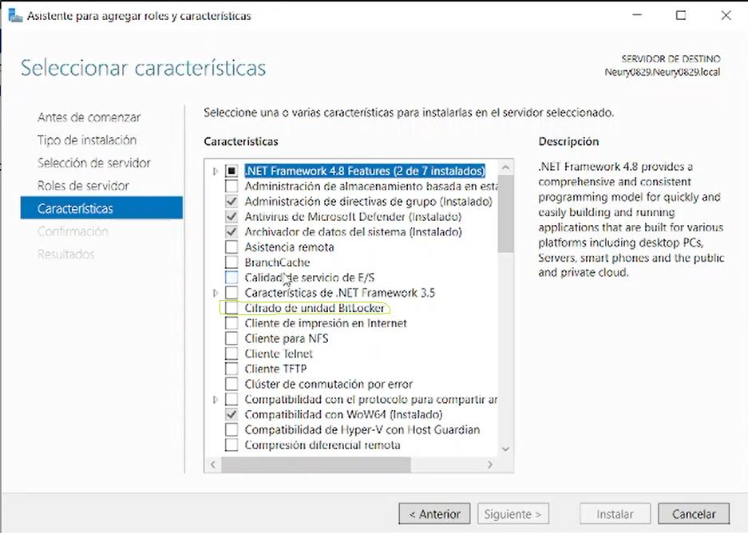


**3.** Aparece un cuadro con las características requeridas (Enhanced Storage y las herramientas de administración de BitLocker, entre ellas el visor de contraseñas de recuperación). Hacemos clic en **Agregar características**.

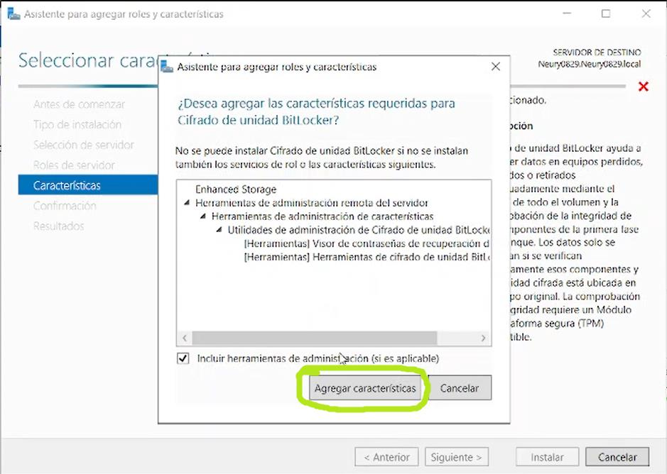


**4.** Hacemos clic en **Siguiente** hasta llegar a la confirmación.

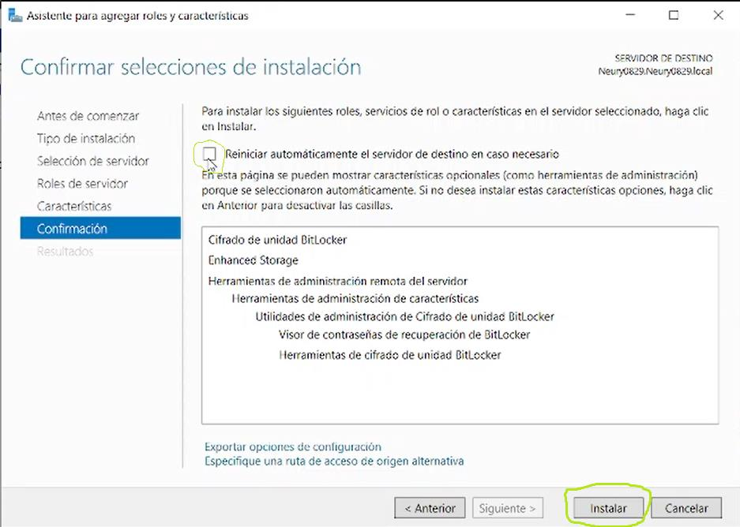


**5.** Marcamos **Reiniciar automáticamente el servidor de destino en caso necesario**, confirmamos con **Sí** y hacemos clic en **Instalar**.

**6.** Esperamos a que finalice la instalación y el reinicio.

### Crear la GPO

**7.** Con la instalación completada, vamos a **Herramientas** y seleccionamos **Administración de directivas de grupo**.

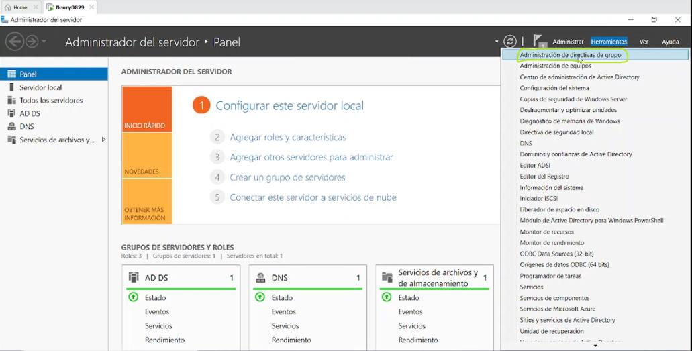


**8.** Hacemos clic derecho sobre nuestro dominio y seleccionamos **Crear un GPO en este dominio y vincularlo aquí**.

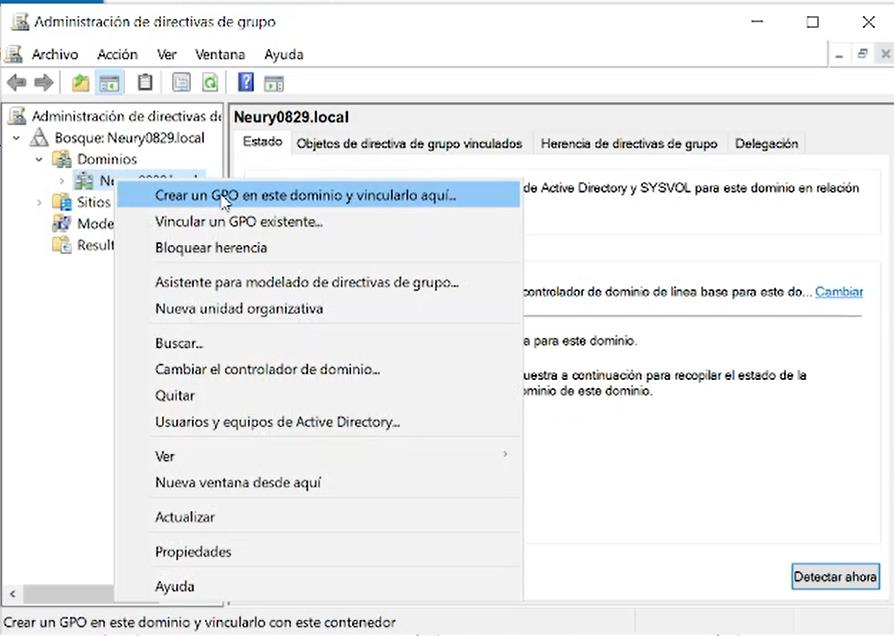


**9.** Le asignamos un nombre; en este caso, `GPO BitLocker`.

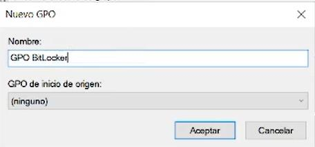


**10.** Hacemos clic en **Aceptar**.

**11.** Desplegamos el dominio para ver la GPO creada.

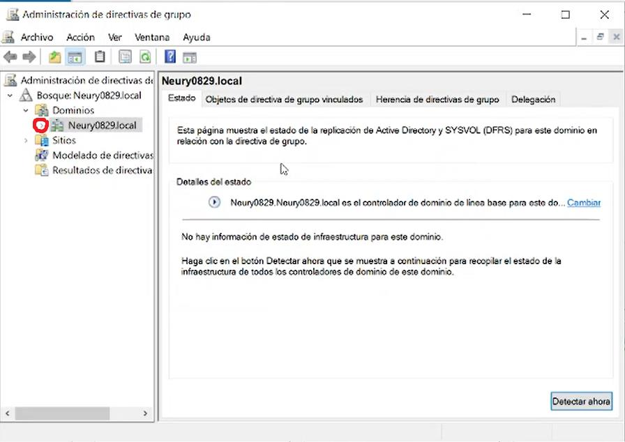


**12.** Hacemos clic derecho sobre la GPO y seleccionamos **Editar**.

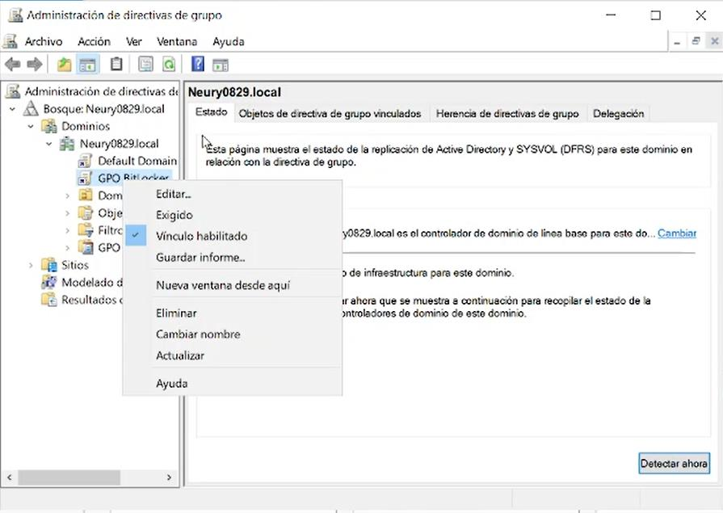


### Configurar las directivas de BitLocker

**13.** En **Configuración del equipo**, desplegamos **Directivas → Plantillas administrativas → Componentes de Windows** y seleccionamos **Cifrado de unidad BitLocker**.

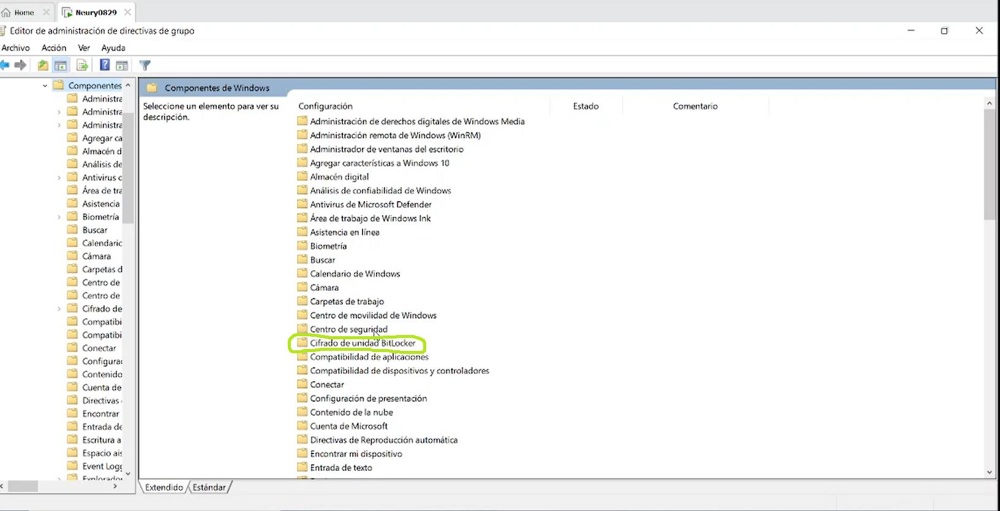


**14.** Hacemos clic en **Unidades del sistema operativo**.

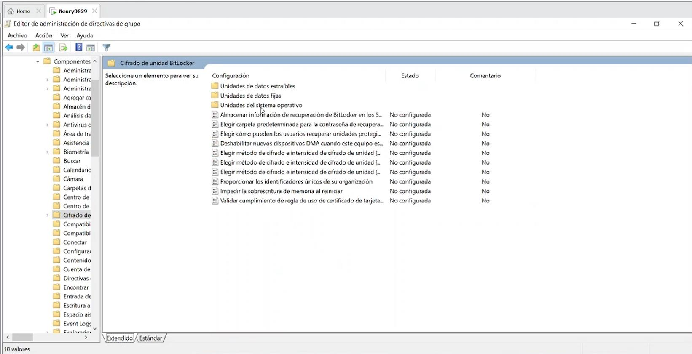


**15.** Configuraremos las directivas siguientes, empezando por **Requerir autenticación adicional al iniciar**.

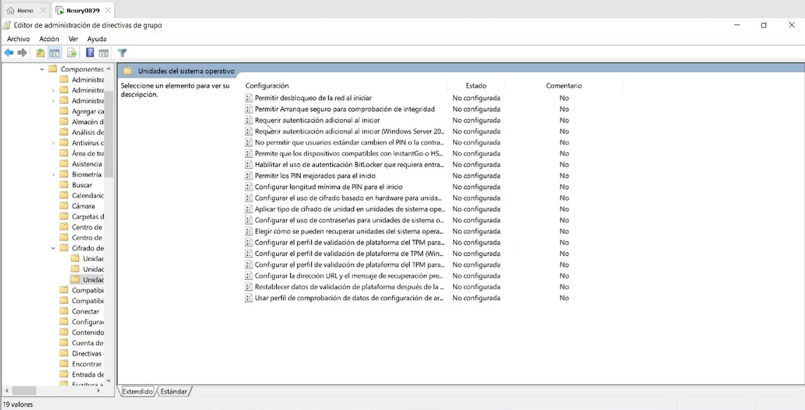


**16.** Hacemos doble clic en la directiva, la **habilitamos**, hacemos clic en **Aplicar** y luego en **Aceptar**.

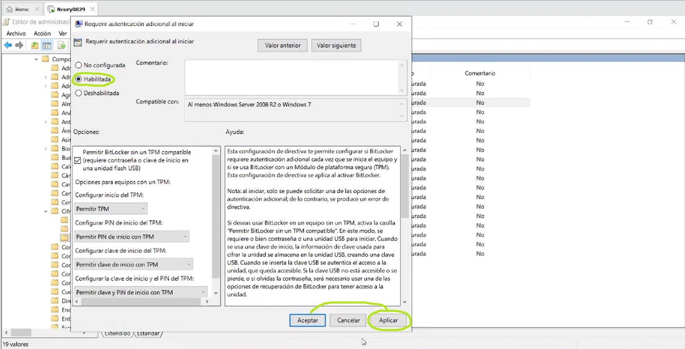


Las opciones de inicio quedan así (permiten el desbloqueo por PIN):

| Opción | Valor |
|---|---|
| Configurar inicio del TPM | Permitir TPM |
| Configurar PIN de inicio del TPM | Permitir PIN de inicio con TPM |
| Configurar clave de inicio del TPM | Permitir clave de inicio con TPM |
| Configurar la clave de inicio y el PIN del TPM | Permitir clave y PIN de inicio con TPM |

> [!NOTE]
> La casilla **Permitir BitLocker sin un TPM compatible** es necesaria en equipos que no tienen TPM, como muchas máquinas virtuales. En ese caso, BitLocker requiere contraseña o clave de inicio en una unidad USB.

**17.** Repetimos el mismo procedimiento con las directivas **Permitir los PIN mejorados para el inicio** y **Configurar longitud mínima de PIN para el inicio**. En esta última establecemos el mínimo de caracteres deseado; en este caso, **4**.

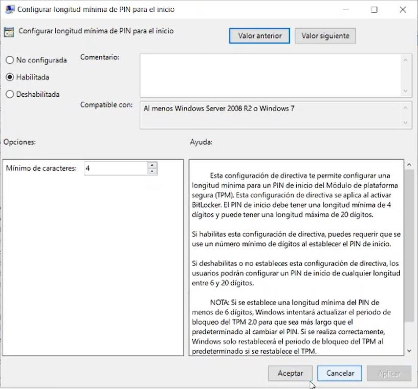


> [!TIP]
> La propia ayuda de la directiva indica que, con una longitud mínima menor a 6 dígitos, Windows intenta ampliar el periodo de bloqueo del TPM 2.0. En un entorno real conviene usar un PIN más largo.

**18.** De la misma forma, habilitamos las directivas de **perfil de validación de plataforma del TPM** (resaltadas en la captura).

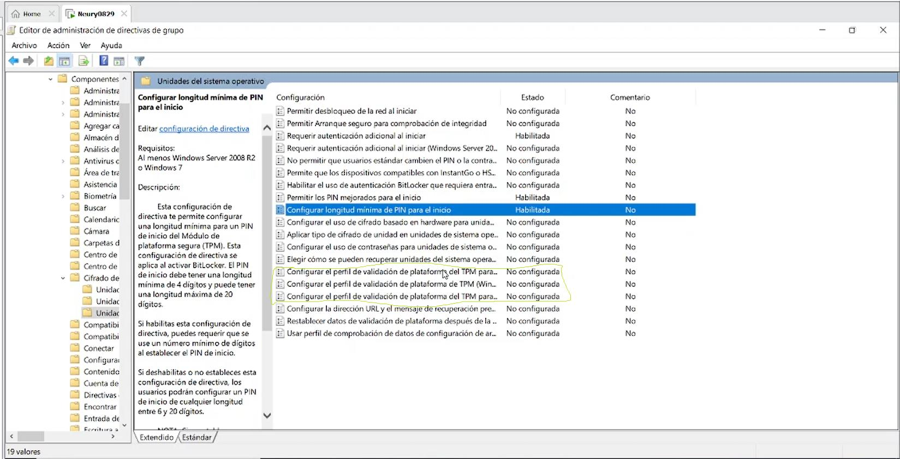


**19.** Hacemos clic en **Retroceder** para volver al nivel de **Cifrado de unidad BitLocker** y abrimos con doble clic la directiva **Almacenar información de recuperación de BitLocker en los Servicios de dominio de Active Directory**.

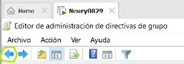

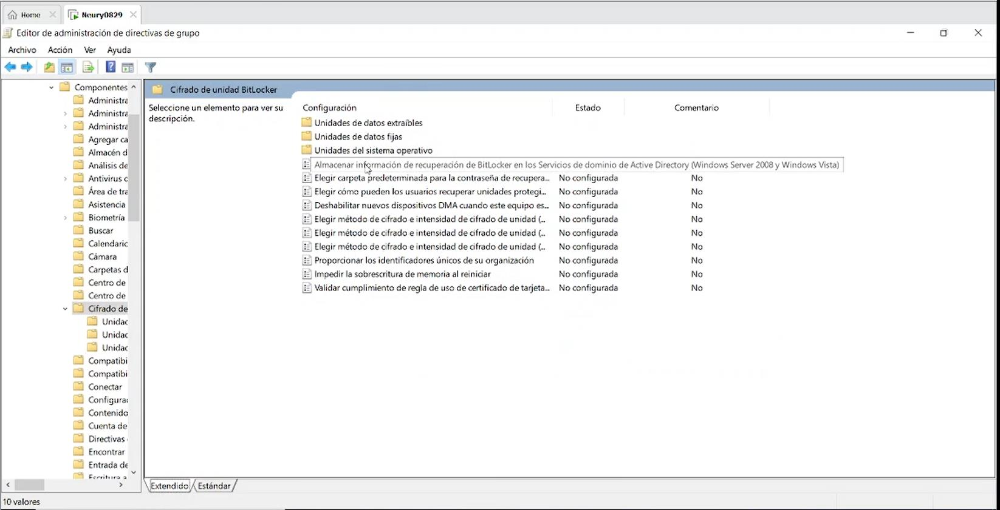


**20.** La **habilitamos** y aplicamos los cambios. Con esto, las claves de recuperación de los equipos cifrados se guardan en Active Directory.

> [!TIP]
> Para equipos con Windows 7 o superior, la copia de seguridad en Active Directory también se controla desde las directivas **Elegir cómo se pueden recuperar...** de cada tipo de unidad (sistema operativo, datos fijos y extraíbles), donde se puede marcar *guardar información de recuperación en AD DS* y exigirla antes de activar BitLocker.

### Aplicar la GPO

**21.** Para aplicar los cambios de manera efectiva, abrimos el **Símbolo del sistema (CMD)** como administrador y ejecutamos:

```cmd
gpupdate /force
```

> [!NOTE]
> Este comando fuerza la aplicación inmediata de las GPO, sin esperar al ciclo normal de actualización.

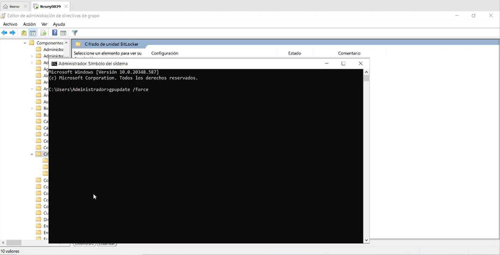


**22.** Presionamos **Enter** y esperamos a que se apliquen las directivas de equipo y de usuario.

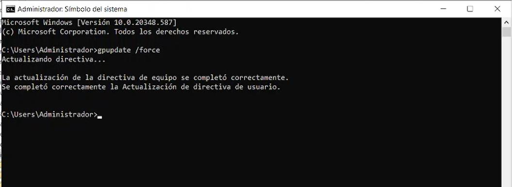


### Cifrar una unidad de prueba

**23.** Para cifrar una unidad, abrimos el Explorador de archivos y creamos una carpeta donde guardaremos la clave de recuperación; en este caso, `Key recovery`.

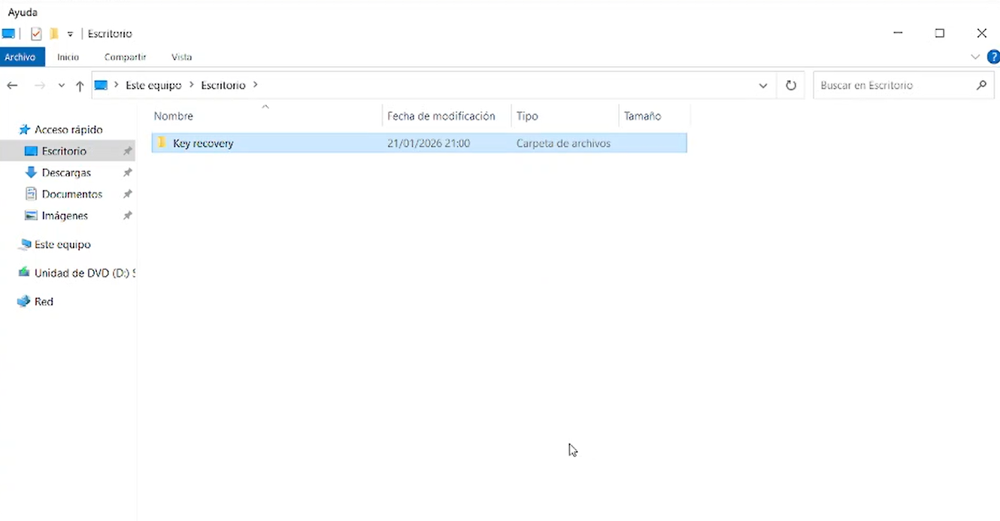


> [!WARNING]
> Esta carpeta es solo para la demostración. En un entorno real, la clave de recuperación no se guarda en el mismo equipo cifrado. Active Directory (paso 20) es el repositorio adecuado. **Nunca subas a GitHub una clave de recuperación real.**

**24.** En **Administración de discos**, hacemos clic derecho sobre el disco `C:`, seleccionamos **Reducir volumen** y establecemos el tamaño de la nueva partición.

**25.** En el espacio sin asignar resultante, hacemos clic derecho y seleccionamos **Nuevo volumen simple**.

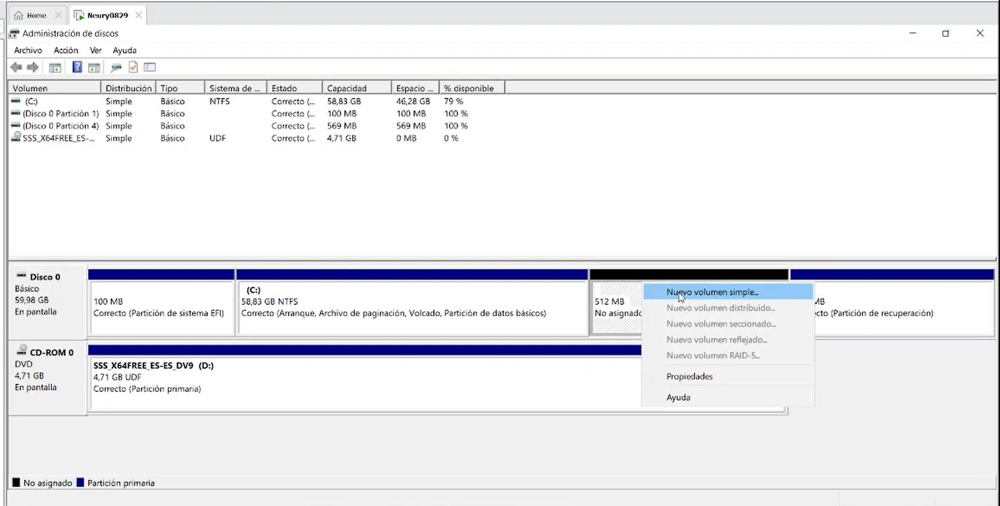


**26.** Seguimos los pasos del asistente.

**27.** Con la partición creada (`E:`), procedemos a cifrarla.

**28.** Hacemos clic derecho sobre la unidad y seleccionamos **Activar BitLocker**.

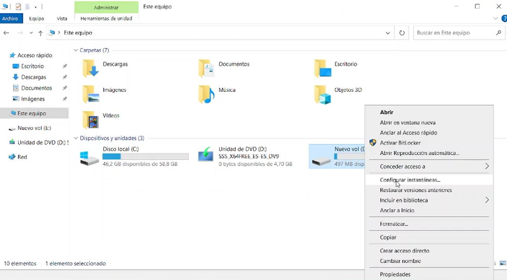


**29.** Elegimos cómo desbloquear la unidad; en este caso, con **contraseña**. La escribimos, la confirmamos y hacemos clic en **Siguiente**.

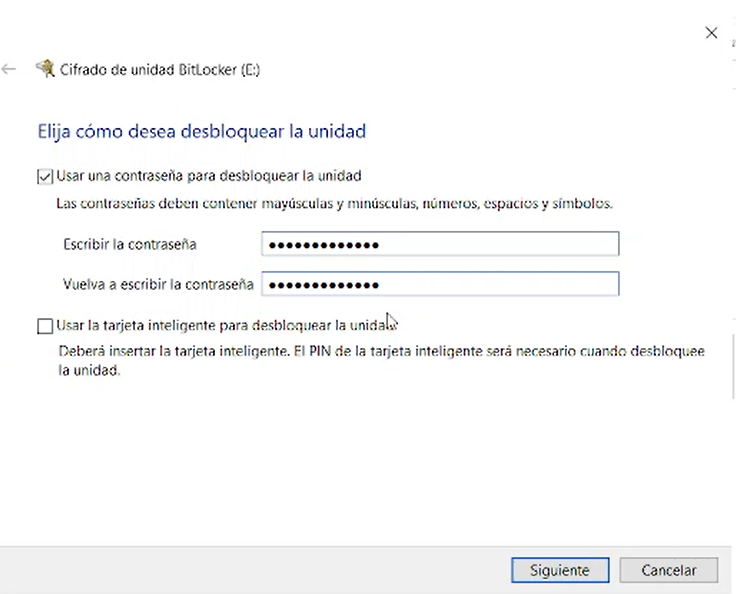


**30.** El asistente pregunta dónde guardar la copia de seguridad de la clave de recuperación. Seleccionamos **Guardar en un archivo** y elegimos la carpeta `Key recovery`.

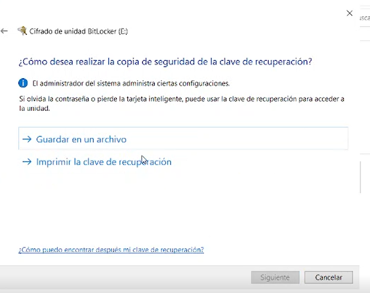

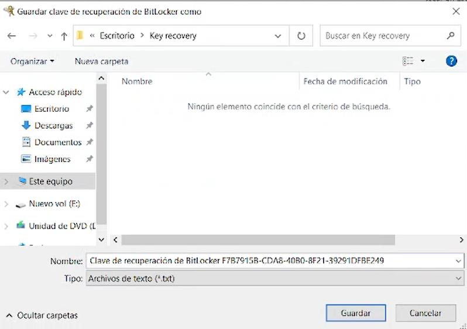


> [!NOTE]
> El mensaje *"El administrador del sistema administra ciertas configuraciones"* confirma que la GPO ya se está aplicando en este equipo.

**31.** Hacemos clic en **Guardar** y luego en **Siguiente**.

**32.** Elegimos cuánto cifrar. Para este caso, seleccionamos **Cifrar la unidad entera**.

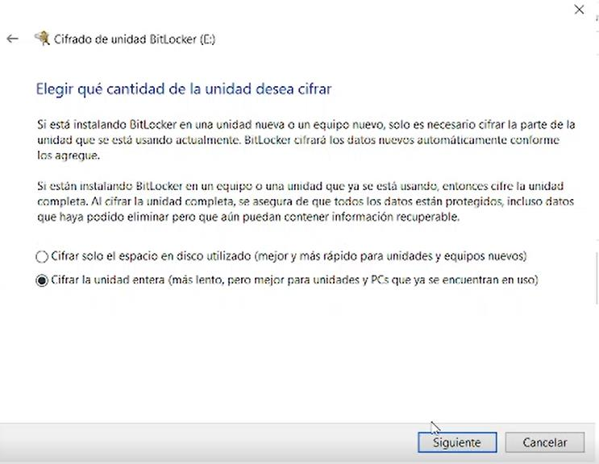


**33.** Elegimos el modo de cifrado. Para este caso, seleccionamos **Modo Compatible** y hacemos clic en **Siguiente**.

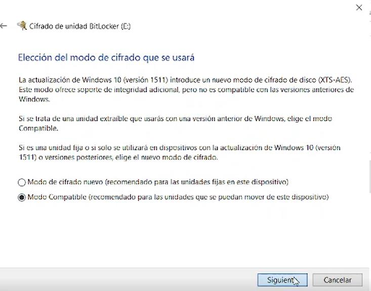


**34.** En la pantalla de confirmación, hacemos clic en **Iniciar cifrado**.

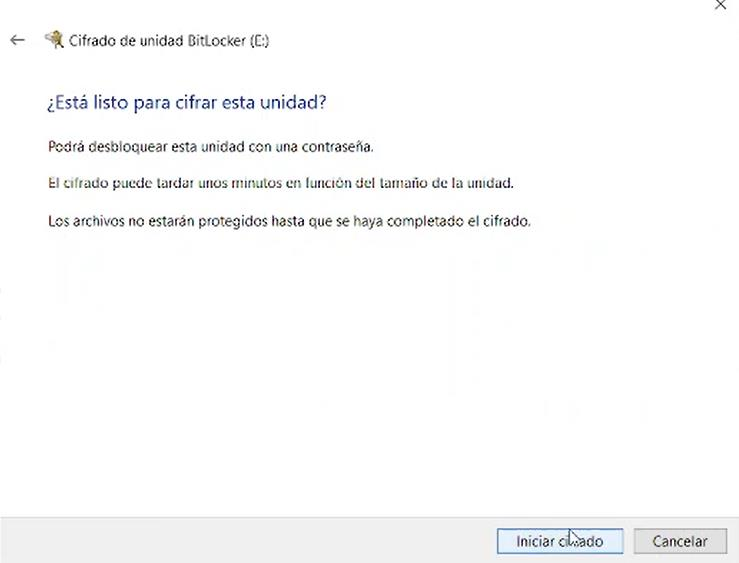


**35.** Esperamos. Al terminar, la unidad aparece cifrada en el Explorador de archivos.

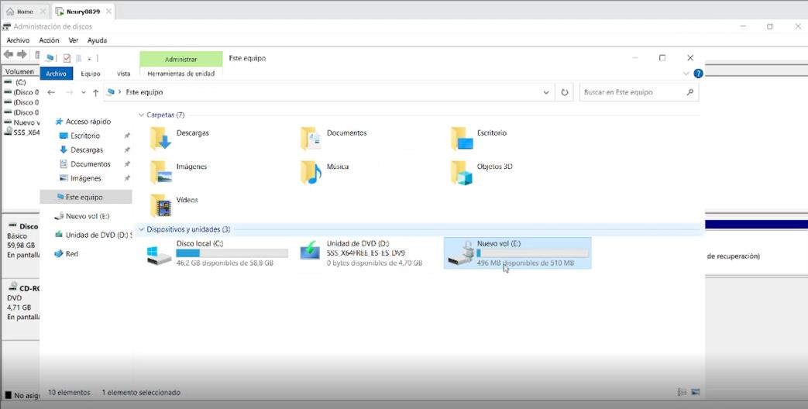


---

## Parte B: Bloqueo de NTLM mediante GPO

**1.** En el Administrador del servidor, hacemos clic en **Herramientas**.

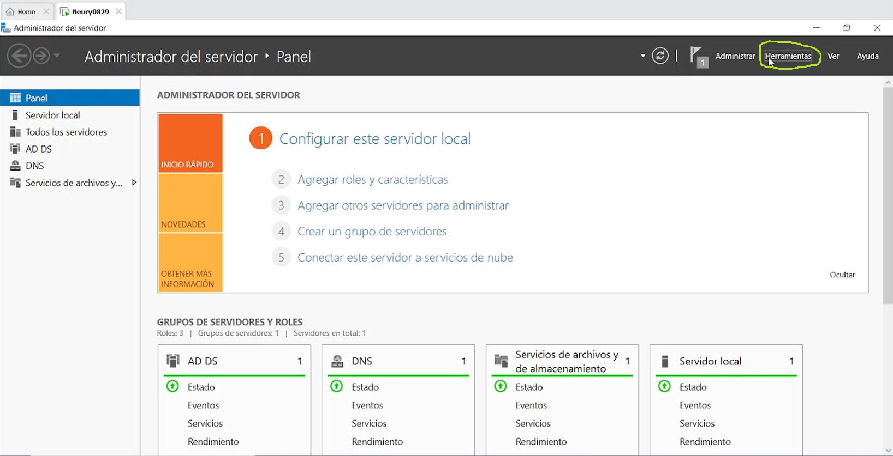


**2.** Seleccionamos **Administración de directivas de grupo**.

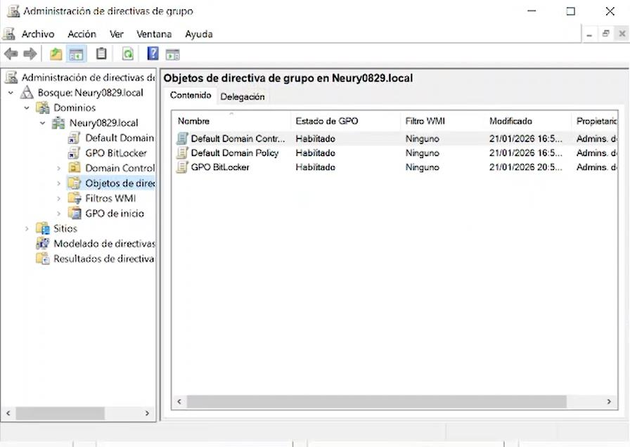


**3.** Hacemos clic derecho sobre el dominio y seleccionamos **Crear un GPO en este dominio y vincularlo aquí**.

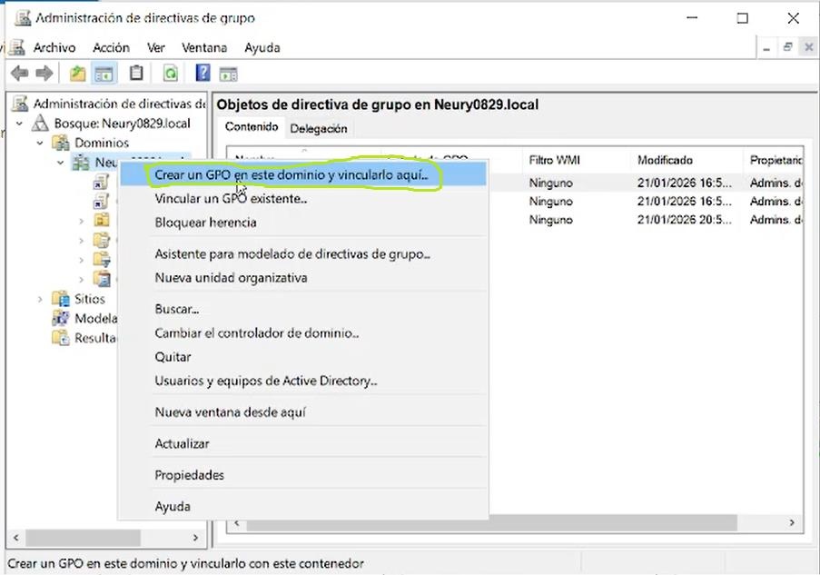


**4.** Le asignamos el nombre que deseemos y hacemos clic en **Aceptar**.

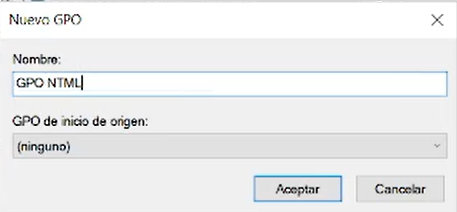


> [!NOTE]
> En las capturas el nombre aparece como `GPO NTML` por un error tipográfico. El nombre correcto del protocolo es **NTLM**.

**5.** Hacemos clic derecho sobre la GPO y seleccionamos **Editar**.

**6.** En **Configuración del equipo**, desplegamos **Directivas → Configuración de Windows → Configuración de seguridad → Directivas locales → Opciones de seguridad**. Aquí buscamos la directiva **Seguridad de red: restringir NTLM: auditar la autenticación NTLM en este dominio**.

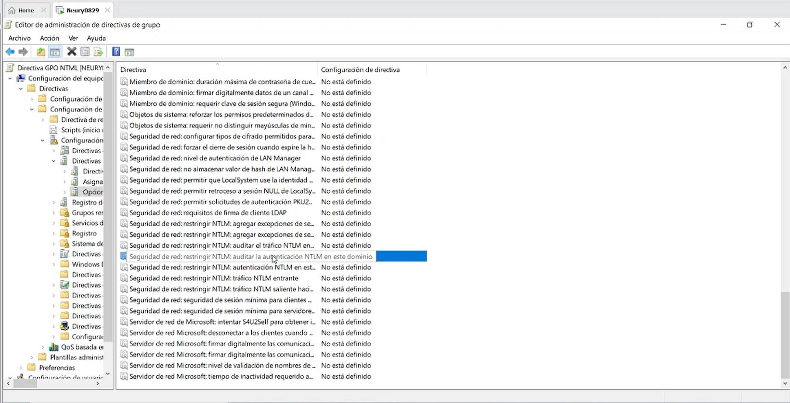


**7.** Hacemos doble clic en ella y marcamos **Definir esta configuración de directiva**.

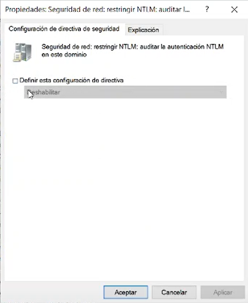


**8.** El valor por defecto es **Deshabilitar**. Lo cambiamos por **Habilitar todo**.

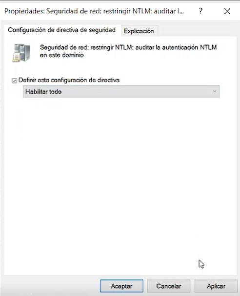


**9.** Hacemos clic en **Aplicar** y luego en **Aceptar**.

**10.** Repetimos el procedimiento con la siguiente directiva: **Seguridad de red: restringir NTLM: autenticación NTLM en este dominio**.

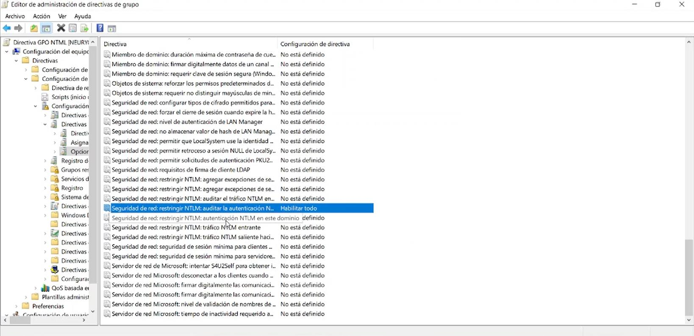


**11.** Aquí, en vez de habilitar, **denegamos todo**: seleccionamos **Denegar todo** para evitar cualquier intento de autenticación NTLM en el dominio.

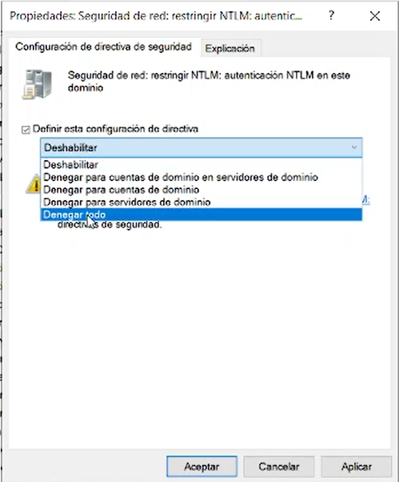


> [!TIP]
> Las dos directivas cumplen funciones distintas. La **primera audita**: registra en el Visor de eventos los intentos de autenticación NTLM. La **segunda bloquea** la autenticación. En un entorno real conviene auditar primero y revisar qué servicios o aplicaciones todavía usan NTLM antes de denegarlo. De lo contrario, pueden dejar de funcionar. Si es necesario, existen directivas para agregar excepciones de servidor.

**12.** Aplicamos los cambios, confirmamos con **Sí** en el aviso y hacemos clic en **Aceptar**.

**13.** Forzamos la aplicación de la directiva desde el CMD:

```cmd
gpupdate /force
```

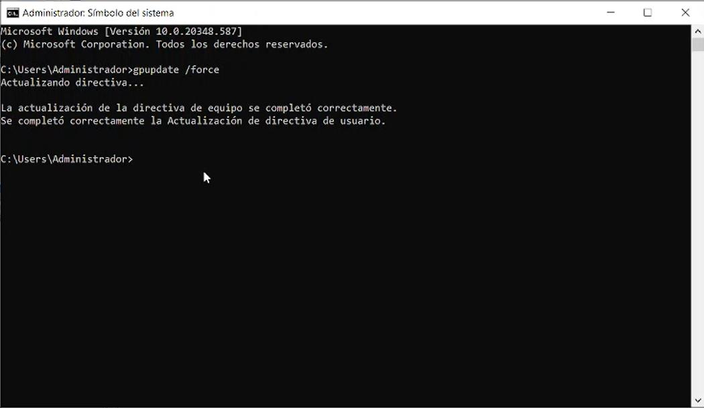


**14.** De vuelta en la consola de directivas de grupo, hacemos clic derecho sobre la GPO de NTLM y seleccionamos **Actualizar** para refrescar la vista.

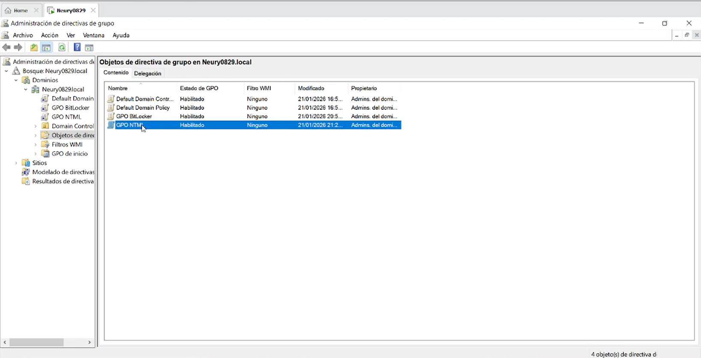

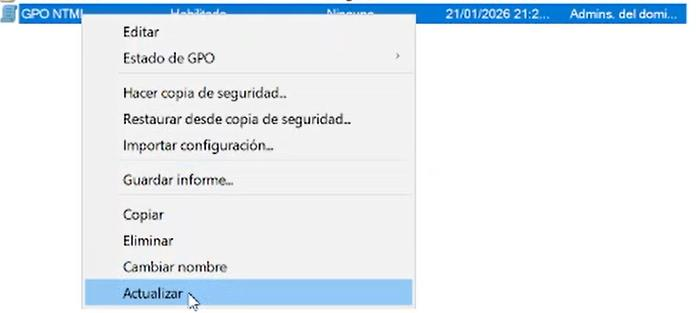


---

## Verificación final

Comandos opcionales para comprobar el resultado.

**GPO aplicadas** (CMD como administrador):

```cmd
gpresult /r /scope computer
```

Debe listar `GPO BitLocker` y la GPO de NTLM entre los objetos de directiva aplicados.

**Estado de BitLocker** (PowerShell como administrador):

```powershell
manage-bde -status E:
Get-BitLockerVolume
```

**Clave de recuperación en Active Directory:** en *Usuarios y equipos de Active Directory*, abre el objeto del equipo cifrado y revisa su pestaña de recuperación de BitLocker (disponible gracias al visor de contraseñas de recuperación instalado en el paso 3).

**Auditoría de NTLM:** en el Visor de eventos, revisa *Registros de aplicaciones y servicios → Microsoft → Windows → NTLM → Operational*.

## Solución de problemas frecuentes

| Problema | Causa probable | Solución |
|---|---|---|
| La GPO no se aplica | Aún no se actualizó la directiva | Ejecutar `gpupdate /force` y revisar con `gpresult /r` |
| BitLocker no permite activarse sin TPM | El equipo no tiene TPM | Habilitar **Permitir BitLocker sin un TPM compatible** en la directiva de autenticación adicional |
| Servicios o aplicaciones dejan de autenticarse | Todavía usaban NTLM | Revisar los eventos de auditoría y, si hace falta, agregar excepciones de servidor |
| Se perdió la contraseña de desbloqueo | — | Usar la clave de recuperación guardada en AD o en el archivo de respaldo |

---

[← Volver al laboratorio](../README.md)
