[← Volver al laboratorio](../README.md)

# 03 · Credential Guard y bloqueo de USB


Tercera práctica del laboratorio. Sobre el dominio de la [práctica 01](../01-active-directory), se crea una unidad organizativa y se usan **directivas de grupo (GPO)** para activar **Credential Guard** (protección de credenciales mediante seguridad basada en la virtualización) y para **bloquear el acceso a dispositivos de almacenamiento extraíble**, entre ellos las unidades USB.

## Objetivos

| Punto | Descripción |
|:--:|---|
| **A** | Crear una GPO que habilite Credential Guard y desplegarla a los equipos del dominio |
| **B** | Crear una GPO que bloquee el acceso de los dispositivos de almacenamiento USB |

## Entorno

| Elemento | Valor |
|---|---|
| Hipervisor | VMware Workstation Pro 17 |
| Servidor (controlador de dominio) | Windows Server 2022, `Neury0829` |
| Cliente | Windows 10 Pro, `WS0829` |
| Dominio | `Neury0829.local` |
| Unidad organizativa | `Empresas` |
| GPO creadas | `GPO Credential Guard` y `GPO Block USB`, vinculadas a la OU `Empresas` |

> [!NOTE]
> A diferencia de la práctica 02 (GPO vinculadas a todo el dominio), aquí las GPO se vinculan a la unidad organizativa **Empresas**. Solo se aplican a los equipos y usuarios que estén dentro de esa OU.

## Requisitos previos

- Prácticas 01 y 02 completadas: dominio funcionando y cliente unido al dominio.
- Sesión iniciada con un usuario administrador del dominio.

## Índice

- [Parte A: Credential Guard mediante GPO](#parte-a-credential-guard-mediante-gpo)
- [Parte B: Bloqueo de almacenamiento USB mediante GPO](#parte-b-bloqueo-de-almacenamiento-usb-mediante-gpo)
- [Verificación final](#verificación-final)
- [Solución de problemas](#solución-de-problemas-frecuentes)

---

## Parte A: Credential Guard mediante GPO

Antes de iniciar, nos encontramos en el Administrador del servidor.

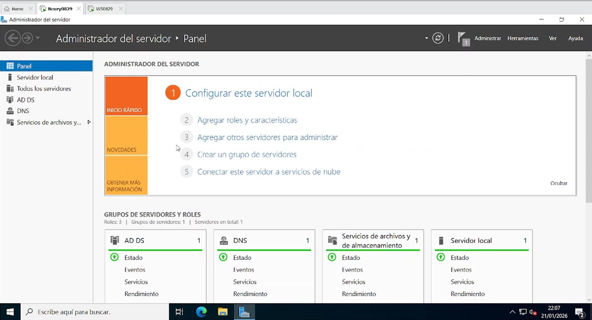


### Crear la unidad organizativa

**1.** Hacemos clic en **Herramientas** y luego en **Administración de directivas de grupo**.

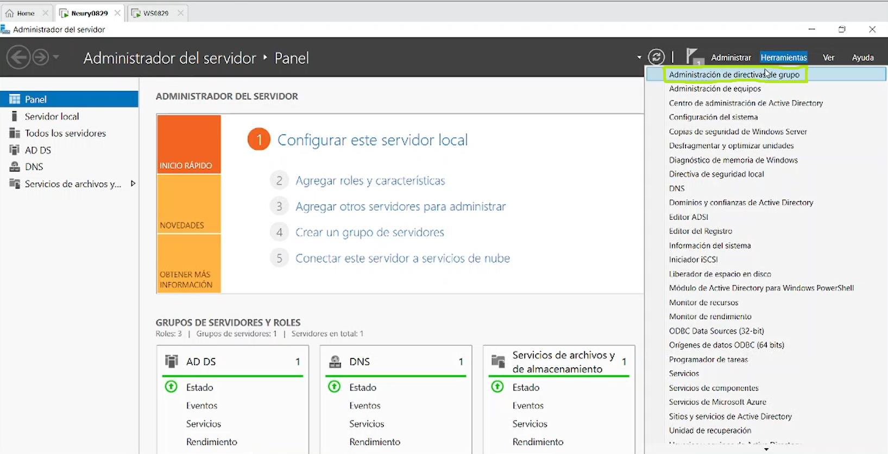


**2.** Se abre la consola de administración de directivas de grupo. Hacemos clic en la flecha a la izquierda del bosque creado anteriormente para desplegar el dominio. Esto nos permite crear la unidad organizativa en el siguiente paso.

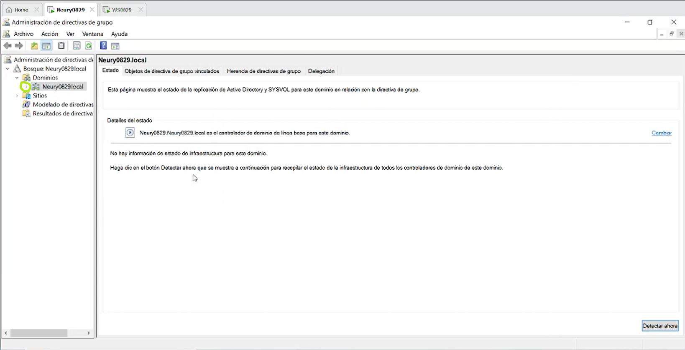


**3.** Hacemos clic derecho sobre el dominio (`Neury0829.local`) y seleccionamos **Nueva unidad organizativa**.

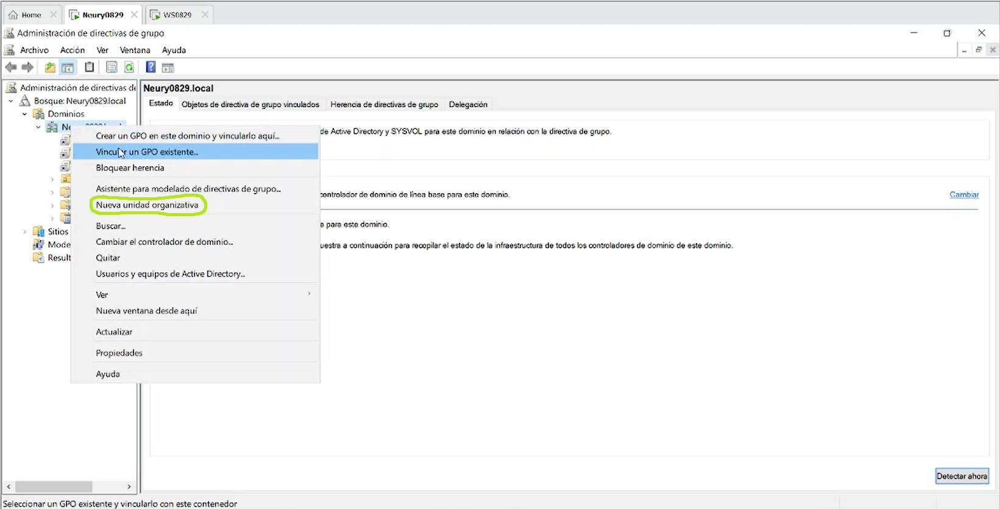


**4.** Nos pedirá un nombre para la unidad organizativa. Lo escribimos y hacemos clic en **Aceptar**; en este caso, `Empresas`.

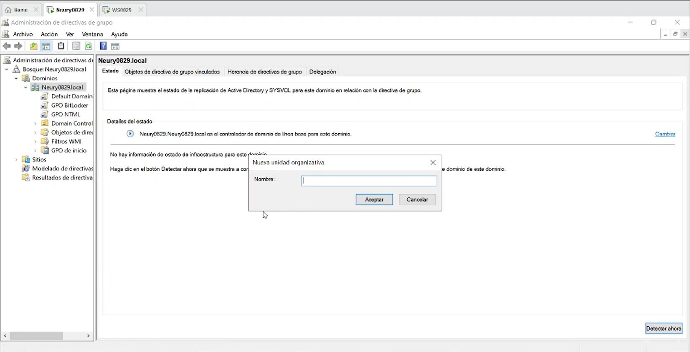

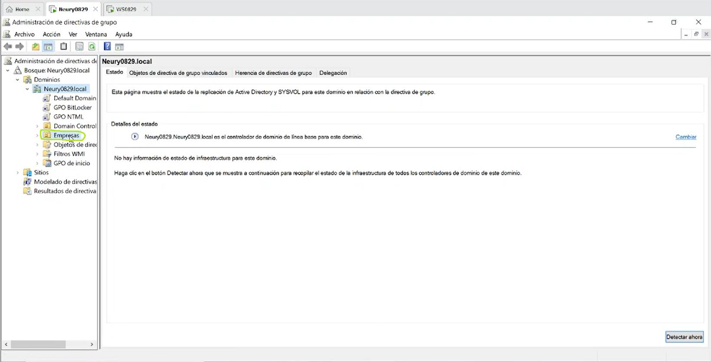


### Crear la GPO

**5.** Con la unidad organizativa creada, hacemos clic derecho sobre ella y seleccionamos **Crear un GPO en este dominio y vincularlo aquí...**.

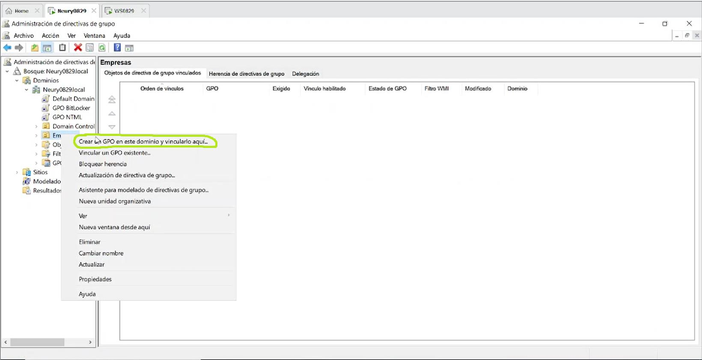


**6.** Escribimos el nombre que consideremos adecuado (en este caso, `GPO Credential Guard`) y hacemos clic en **Aceptar**.

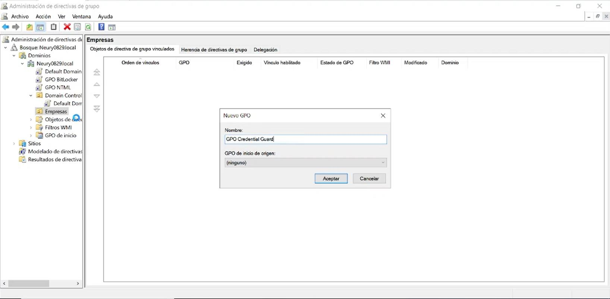


**7.** Hacemos clic derecho sobre la GPO creada y seleccionamos **Editar**.

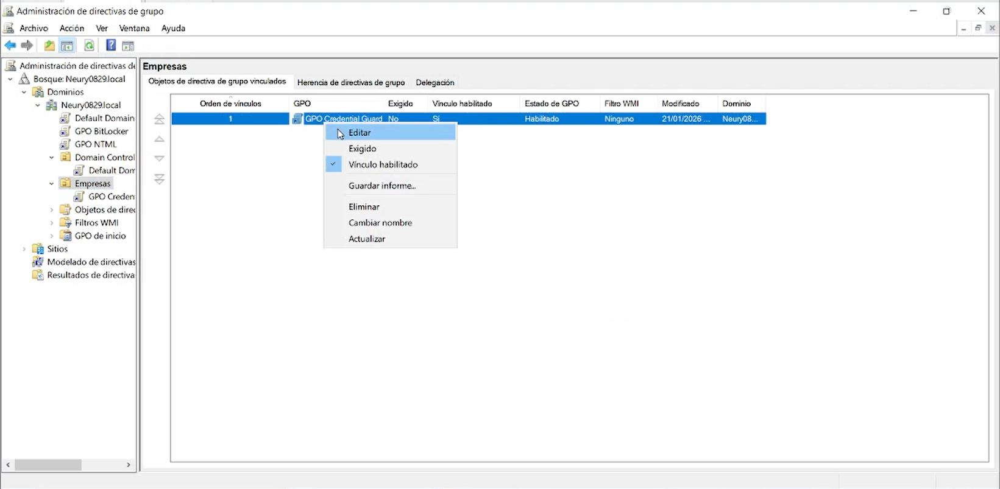


**8.** Se abre el editor de administración de directivas de grupo.

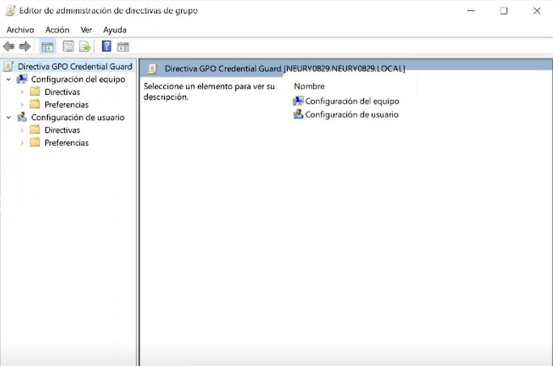


### Configurar Credential Guard

**9.** En **Configuración del equipo**, desplegamos **Directivas → Plantillas administrativas → Sistema → Device Guard**.

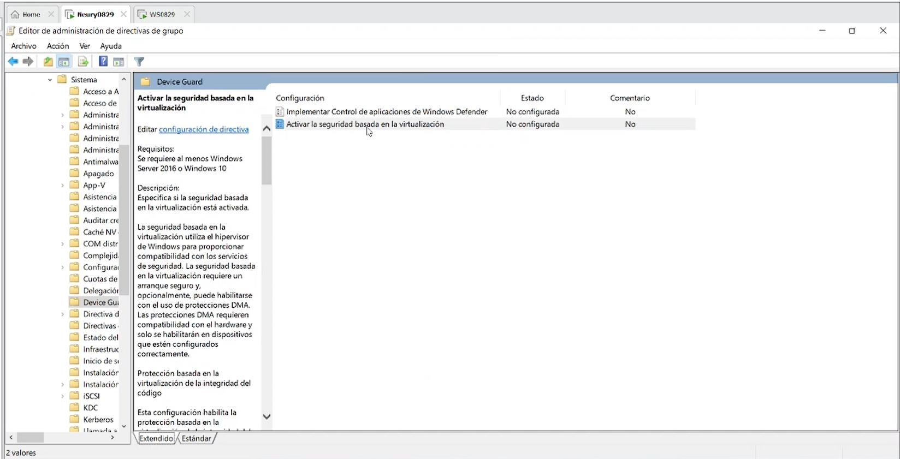


**10.** Hacemos doble clic en **Activar la seguridad basada en la virtualización**.

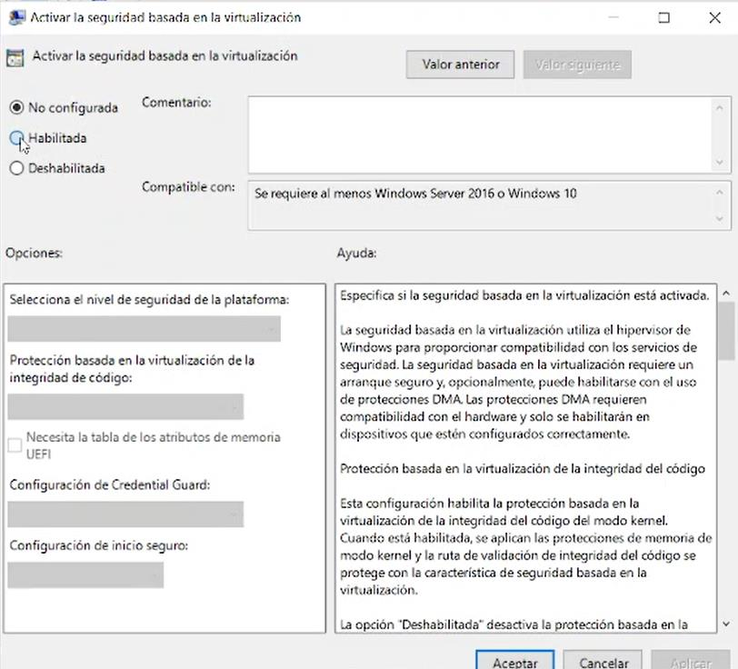


**11.** Habilitamos la seguridad basada en la virtualización y configuramos las opciones:

| Opción | Valor |
|---|---|
| Activar la seguridad basada en la virtualización | **Habilitada** |
| Nivel de seguridad de la plataforma | Arranque seguro y protección de DMA |
| Protección basada en la virtualización de la integridad de código | **Habilitado con el bloqueo UEFI** |
| Configuración de Credential Guard | **Habilitado con el bloqueo UEFI** |

Hacemos clic en **Aplicar** y luego en **Aceptar**.

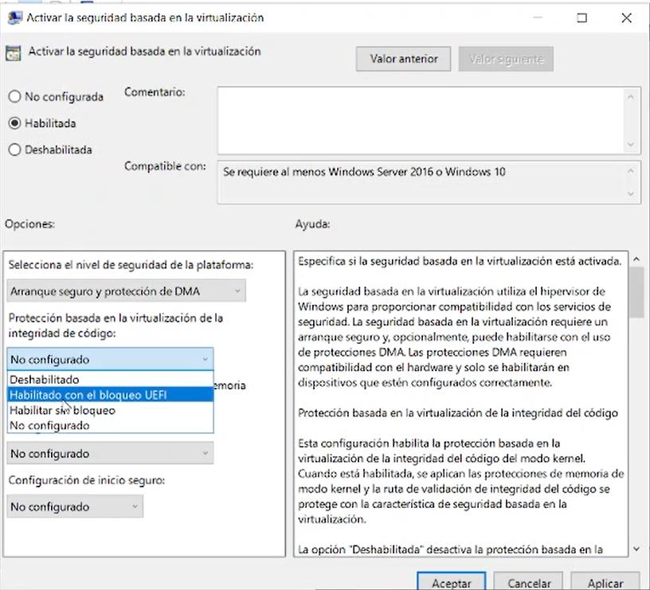

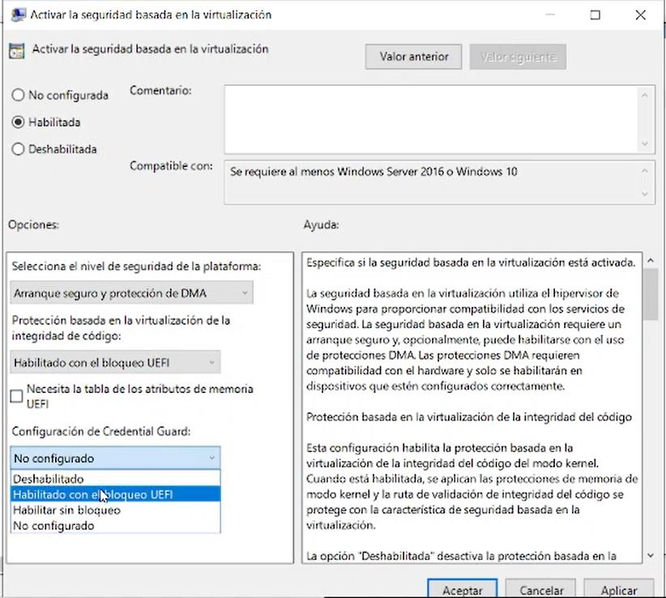


> [!WARNING]
> **Bloqueo UEFI.** Con *Habilitado con el bloqueo UEFI*, la configuración se guarda en variables de firmware y **no se desactiva simplemente quitando la GPO**: se requieren pasos manuales adicionales en cada equipo. Si solo quieres probar la función, la opción *Habilitar sin bloqueo* es más fácil de revertir.

### Aplicar la GPO

**12.** Abrimos el **Símbolo del sistema (CMD)** y ejecutamos:

```cmd
gpupdate /force
```

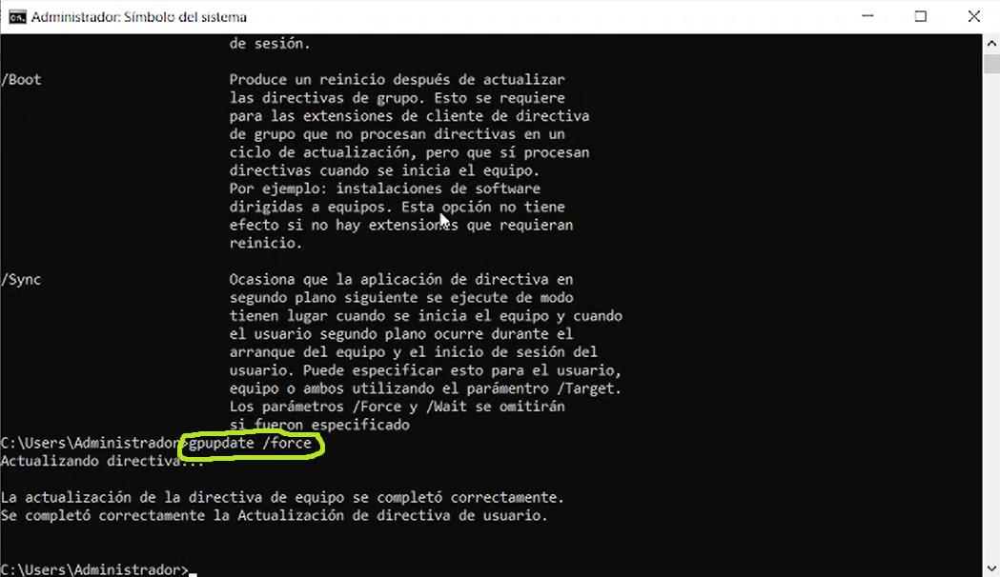


> [!NOTE]
> Este comando fuerza la aplicación inmediata de las directivas de grupo.

### Comprobar en el cliente

**13.** Nos dirigimos al cliente (en este caso, Windows 10 Pro) y partimos desde el escritorio.

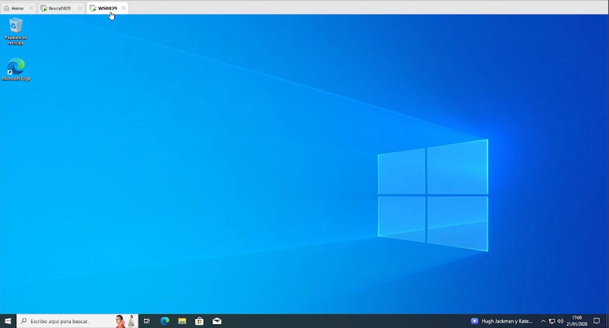


**14.** Abrimos **PowerShell**, ejecutamos el siguiente comando y presionamos **Enter**:

```powershell
Get-CimInstance -ClassName Win32_DeviceGuard -Namespace root\Microsoft\Windows\DeviceGuard
```

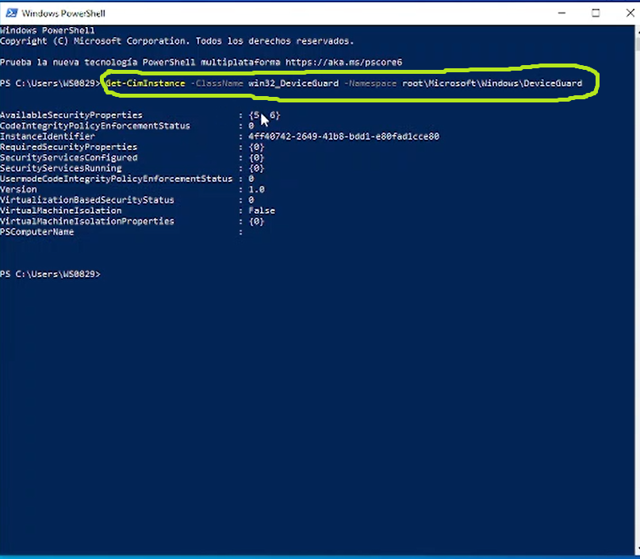


Este comando muestra las capacidades de seguridad basada en la virtualización del equipo y su estado actual. Así se interpretan los campos relevantes de la captura:

| Campo | Valor en la captura | Significado |
|---|:--:|---|
| `AvailableSecurityProperties` | `{5, 6}` | Propiedades de hardware disponibles: 5 = protecciones NX y 6 = mitigaciones de SMM |
| `SecurityServicesConfigured` | `{0}` | Ningún servicio configurado (1 = Credential Guard, 2 = HVCI) |
| `SecurityServicesRunning` | `{0}` | Ningún servicio en ejecución |
| `VirtualizationBasedSecurityStatus` | `0` | Seguridad basada en la virtualización no habilitada (2 = en ejecución) |

> [!IMPORTANT]
> En esta captura, Credential Guard **todavía no aparece configurado ni en ejecución** en el cliente. Los valores `5` y `6` describen capacidades del hardware y **no** indican que Credential Guard esté activo.

#### Para dejar Credential Guard activo en el cliente

1. Mover el objeto del equipo cliente (`WS0829`) a la unidad organizativa **Empresas**, desde *Usuarios y equipos de Active Directory*, porque la GPO solo aplica a esa OU.
2. Ejecutar `gpupdate /force` **en el cliente** y reiniciarlo.
3. Comprobar los requisitos: Windows 10/11 **Enterprise o Education** (Credential Guard no está incluido en Windows 10 Pro), arranque **UEFI con Secure Boot** y virtualización de CPU habilitada en la máquina virtual.
4. Volver a ejecutar el comando. Con Credential Guard activo se espera `SecurityServicesConfigured` y `SecurityServicesRunning` con el valor `{1}` y `VirtualizationBasedSecurityStatus` en `2`.

---

## Parte B: Bloqueo de almacenamiento USB mediante GPO

**1.** Volvemos a la administración de directivas de grupo y, en la unidad organizativa `Empresas`, creamos otra GPO.

**2.** Establecemos el nombre requerido (en este caso, `GPO Block USB`) y hacemos clic en **Aceptar**.

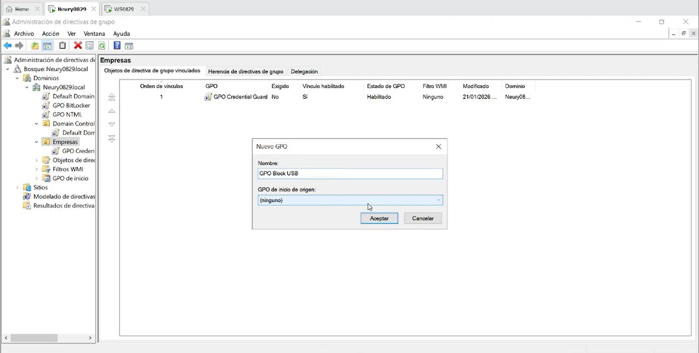


**3.** Hacemos clic derecho sobre la GPO creada y seleccionamos **Editar**.

**4.** Se abre el editor de administración de directivas de grupo.

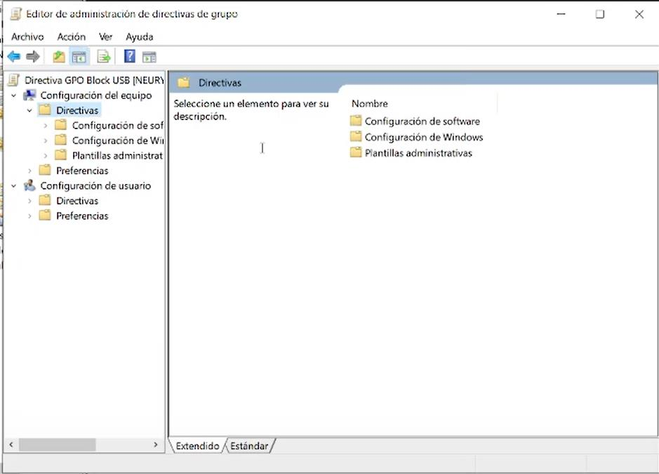


**5.** Nos dirigimos a **Configuración del equipo → Directivas → Plantillas administrativas → Sistema → Acceso de almacenamiento extraíble**.

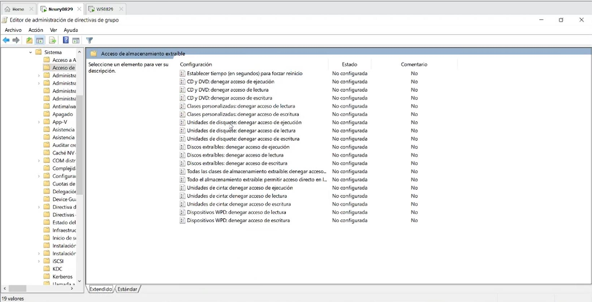


**6.** Hacemos doble clic en **Todas las clases de almacenamiento extraíble: denegar acceso a todo**.

**7.** La **habilitamos**, hacemos clic en **Aplicar** y luego en **Aceptar**.

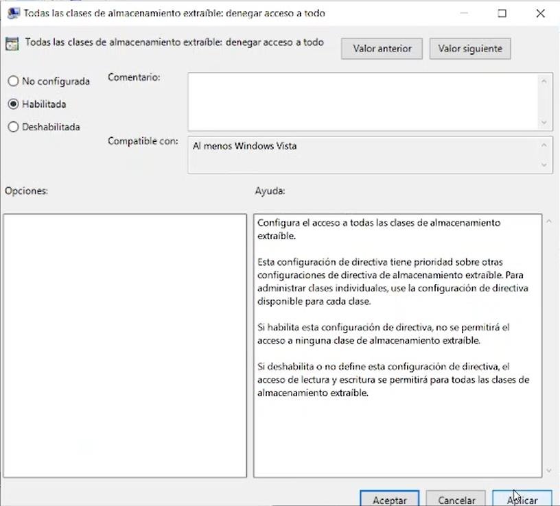


> [!NOTE]
> Esta directiva tiene prioridad sobre las demás directivas individuales de almacenamiento extraíble y bloquea **todas** las clases (discos extraíbles como las unidades USB, CD/DVD, disquetes, cintas y dispositivos WPD, como teléfonos), no solo las unidades USB.

---

## Verificación final

Comandos y pruebas opcionales.

**GPO aplicadas** (en el cliente, CMD como administrador):

```cmd
gpresult /r /scope computer
```

Debe listar `GPO Credential Guard` y `GPO Block USB` entre los objetos de directiva aplicados (requiere que el equipo esté en la OU `Empresas`).

**Estado de Credential Guard** (PowerShell en el cliente):

```powershell
Get-CimInstance -ClassName Win32_DeviceGuard -Namespace root\Microsoft\Windows\DeviceGuard |
  Select-Object SecurityServicesConfigured, SecurityServicesRunning, VirtualizationBasedSecurityStatus
```

También puedes abrir `msinfo32` y revisar *Servicios de seguridad basados en la virtualización en ejecución*.

**Bloqueo de USB:** en VMware, conecta una unidad USB a la máquina virtual (*VM → Removable Devices*) y comprueba que el acceso a la unidad sea denegado en el cliente.

## Solución de problemas frecuentes

| Problema | Causa probable | Solución |
|---|---|---|
| La GPO no se aplica al cliente | El equipo no está en la OU `Empresas` | Mover el objeto del equipo a la OU y ejecutar `gpupdate /force` |
| Credential Guard no se ejecuta | Faltan requisitos del equipo | Usar Windows Enterprise/Education, arranque UEFI con Secure Boot y virtualización habilitada |
| Credential Guard sigue activo al quitar la GPO | Se usó el bloqueo UEFI | Seguir el procedimiento manual de desactivación (variables de firmware) en cada equipo |
| La unidad USB sigue accesible | La directiva aún no se aplicó | Ejecutar `gpupdate /force`, cerrar sesión o reiniciar y revisar con `gpresult` |
| Otros dispositivos extraíbles también quedan bloqueados | La directiva abarca todas las clases | Usar las directivas individuales por clase si solo se desea bloquear algunas |

---

[← Volver al laboratorio](../README.md)
