[← Volver al laboratorio](../README.md)

# 05 · LAPS y Visor de Eventos


Quinta práctica del laboratorio. Se instala y configura **Microsoft LAPS** (*Local Administrator Password Solution*) mediante una GPO para administrar las contraseñas de las cuentas de administrador local, y se utiliza el **Visor de eventos** para auditar eventos clave de apagado, inicio de servicios e inicios de sesión.

## Objetivos

| Punto | Descripción |
|:--:|---|
| **A** | Habilitar LAPS para la modificación de contraseñas de usuarios locales |
| **B** | Instalar y configurar LAPS mediante GPO |
| **C** | Garantizar que las contraseñas cumplan con un mínimo de 16 caracteres |
| **D** | Realizar búsquedas de eventos en el Visor de eventos (1074, 6005, 6006, 4624, 4625 y 4719) y explicar en qué consisten |

## Entorno

| Elemento | Valor |
|---|---|
| Hipervisor | VMware Workstation Pro 17 |
| Servidor (controlador de dominio) | Windows Server 2022, `Neury0829` |
| Dominio | `Neury0829.local` |
| Unidad organizativa | `Empresas` |
| GPO creada | `LAPS`, vinculada a la OU `Empresas` |

> [!NOTE]
> La GPO `LAPS` está vinculada a la unidad organizativa **Empresas**. Solo se aplica a los equipos que estén dentro de esa OU.

## Requisitos previos

- Prácticas 01 a 04 completadas: dominio funcionando y unidad organizativa `Empresas` creada.
- Instalador **LAPS.x64** descargado desde la página oficial de Microsoft.
- Sesión iniciada con un usuario administrador del dominio.

## Índice

- [Parte A: Instalar LAPS](#parte-a-instalar-laps)
- [Parte B: Crear y configurar la GPO de LAPS](#parte-b-crear-y-configurar-la-gpo-de-laps)
- [Parte C: Contraseñas de mínimo 16 caracteres](#parte-c-contraseñas-de-mínimo-16-caracteres)
- [Parte D: Auditoría con el Visor de eventos](#parte-d-auditoría-con-el-visor-de-eventos)
- [Demostración en video](#demostración-en-video)
- [Pasos adicionales para LAPS](#pasos-adicionales-para-que-laps-funcione-de-extremo-a-extremo)
- [Lo aprendido](#lo-aprendido)
- [Solución de problemas](#solución-de-problemas-frecuentes)

---

## Parte A: Instalar LAPS

Partimos desde el escritorio, con el archivo **LAPS.x64** descargado previamente.

**1.** Hacemos doble clic en el instalador. Se abre el asistente de instalación.

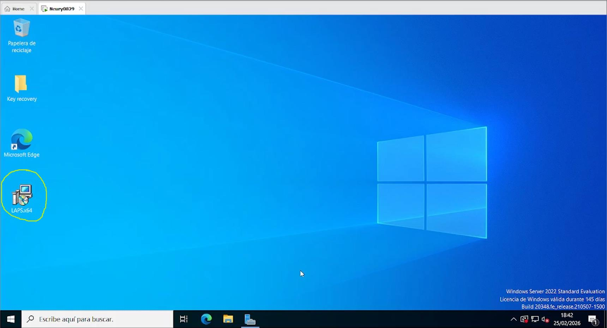


**2.** Hacemos clic en **Next** hasta llegar a la pantalla **Custom Setup**.

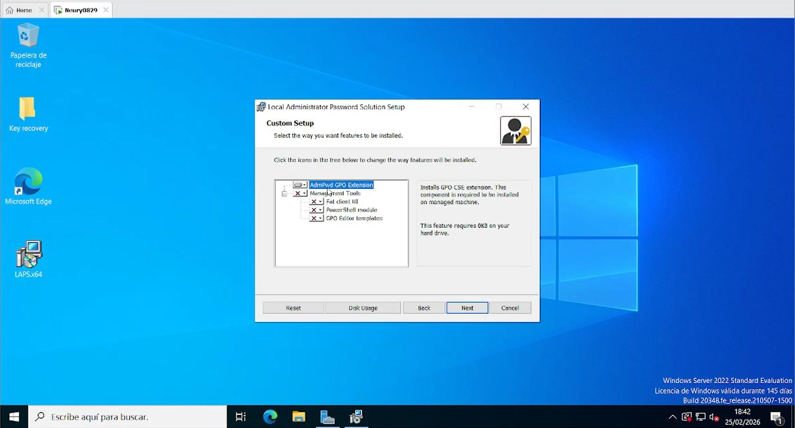


**3.** En **Custom Setup**, configuramos cada componente para que se instale en el disco local: hacemos clic en el icono de la **X** de cada uno y seleccionamos **Will be installed on local hard drive**.

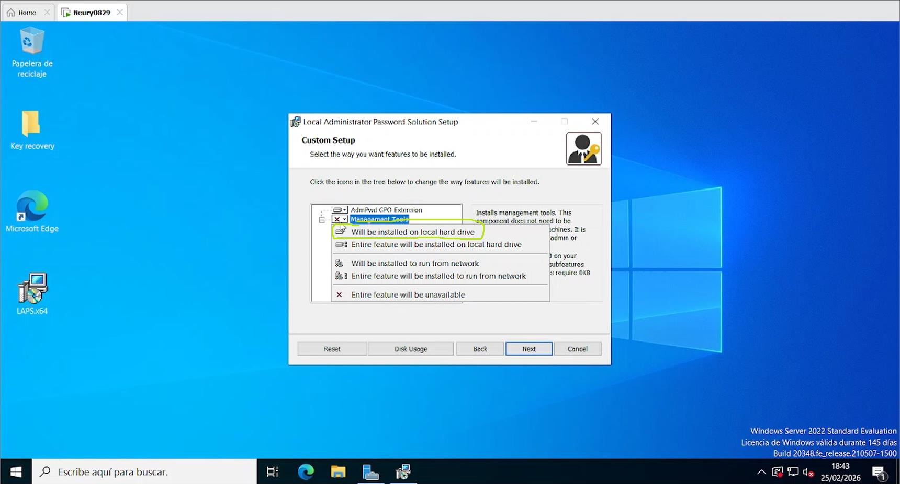


Con la configuración aplicada a cada componente (*AdmPwd GPO Extension* y las herramientas de administración: *Fat client UI*, *PowerShell module* y *GPO Editor templates*), debe quedar así:


**4.** Hacemos clic en **Next** hasta aplicar la configuración y luego en **Finish**.

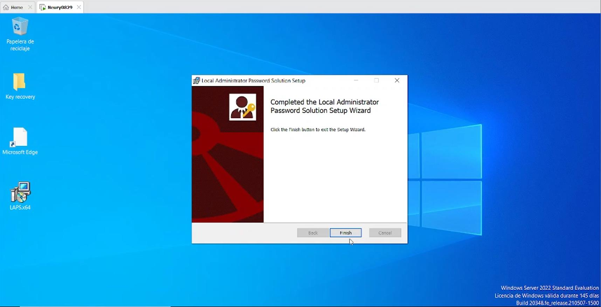


---

## Parte B: Crear y configurar la GPO de LAPS

**1.** Vamos al Administrador del servidor.

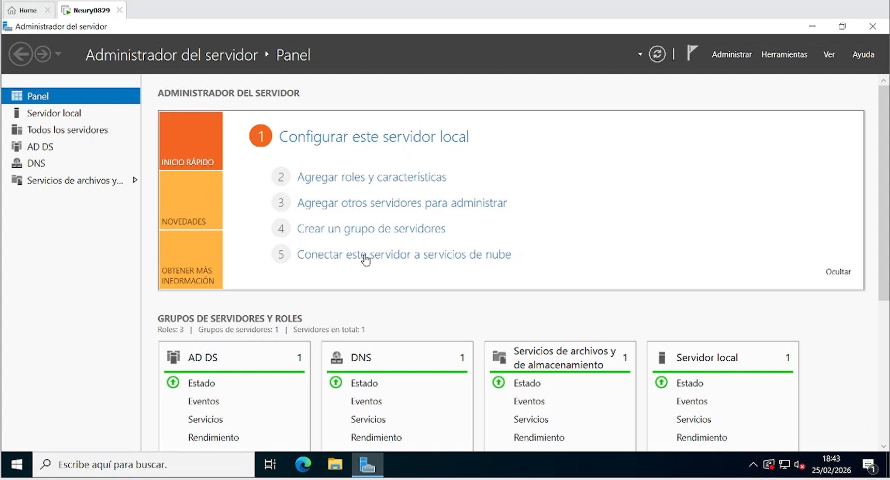


**2.** Hacemos clic en **Herramientas** y luego en **Administración de directivas de grupo**.

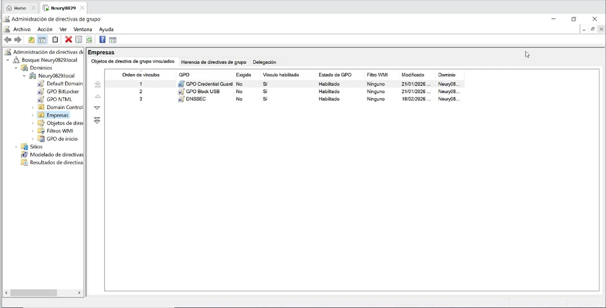


**3.** Creamos una GPO y la vinculamos a la unidad organizativa `Empresas`: clic derecho sobre la OU y **Crear un GPO en este dominio y vincularlo aquí...**.


**4.** Establecemos el nombre (en este caso, `LAPS`) y hacemos clic en **Aceptar**.

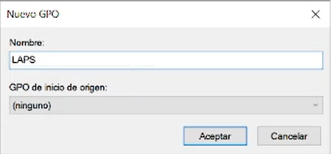


**5.** Hacemos clic derecho sobre la GPO creada y seleccionamos **Editar**.

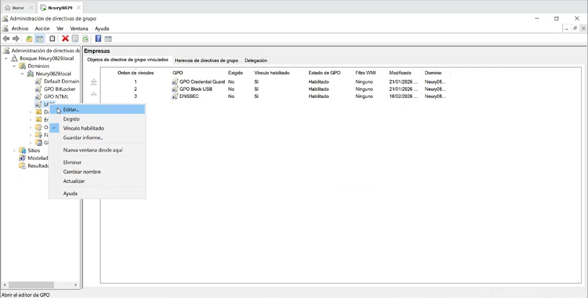


**6.** Se abre el editor de administración de directivas de grupo.


**7.** En **Configuración del equipo**, desplegamos **Directivas → Plantillas administrativas → LAPS**. Allí aparecen las cuatro directivas de LAPS: *Password Settings*, *Name of administrator account to manage*, *Do not allow password expiration time longer than required by policy* y *Enable local admin password management*.

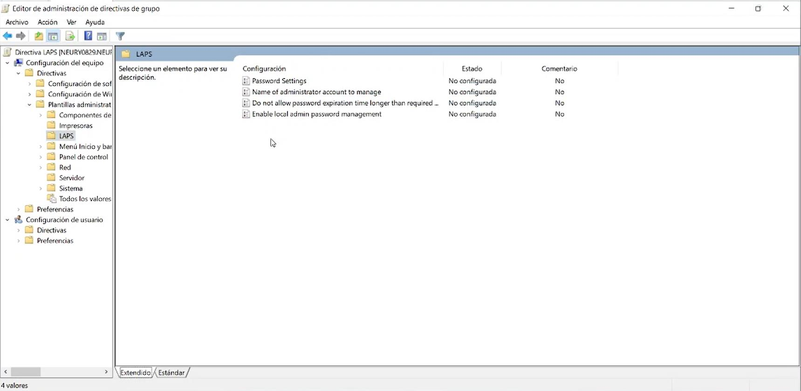


---

## Parte C: Contraseñas de mínimo 16 caracteres

**1.** Partiendo del punto anterior, hacemos doble clic en **Password Settings** y **habilitamos** la regla. Dejamos la complejidad de la contraseña por defecto y cambiamos la longitud mínima de **14** a **16**.

| Opción | Valor |
|---|---|
| Password Settings | **Habilitada** |
| Password Complexity | Large letters + small letters + numbers + specials (por defecto) |
| Password Length | **16** (por defecto: 14) |
| Password Age (Days) | 30 |

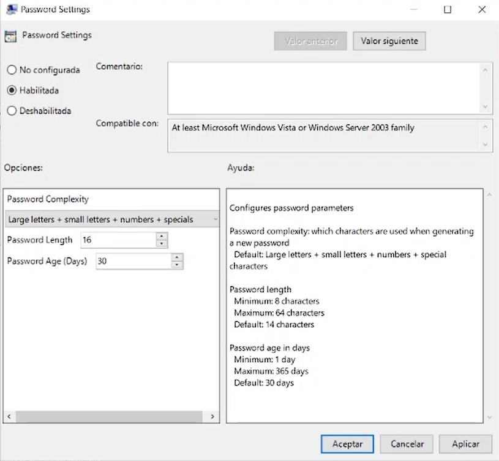


**2.** Hacemos clic en **Aplicar** y luego en **Aceptar**.

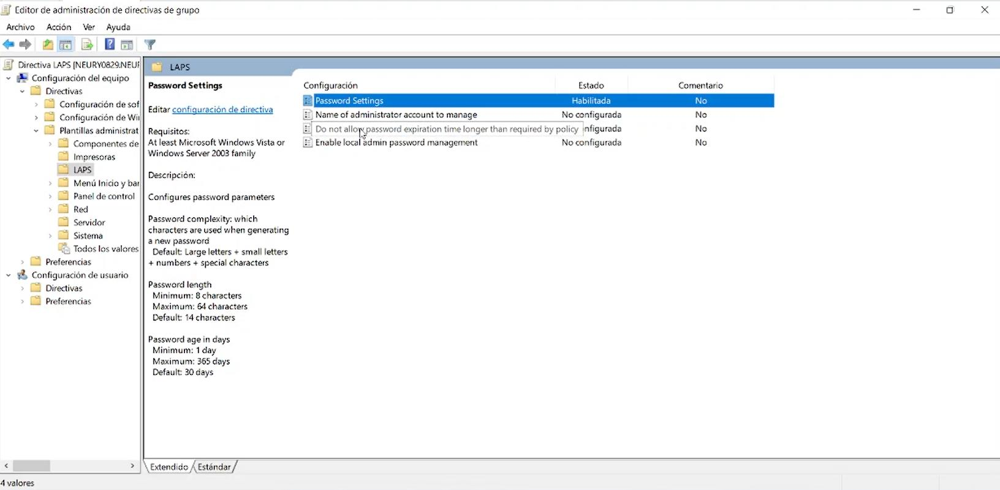


**3.** Habilitamos también la directiva **Do not allow password expiration time longer than required by policy**.

> [!NOTE]
> Esta directiva impide que la fecha de expiración planificada de una contraseña sea más lejana que la edad de contraseña definida en *Password Settings*. Si se detecta esa situación, la contraseña se cambia inmediatamente y la expiración se establece según la directiva.

**4.** Hacemos clic en **Aplicar** y luego en **Aceptar**.

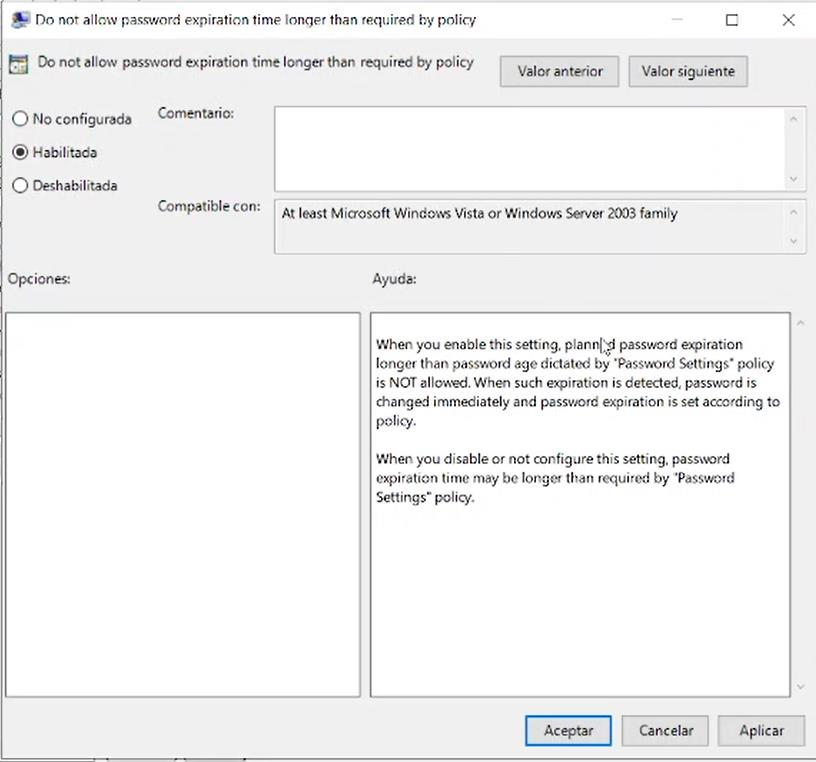


> [!IMPORTANT]
> En las capturas, la directiva **Enable local admin password management** aparece como *No configurada*. Para que LAPS administre realmente las contraseñas, esa directiva debe estar **habilitada**. Consulta la sección [Pasos adicionales para LAPS](#pasos-adicionales-para-que-laps-funcione-de-extremo-a-extremo).

---

## Parte D: Auditoría con el Visor de eventos

Se buscan seis eventos y se explica en qué consiste cada uno.

| Event ID | Registro | En qué consiste | Resultado en el laboratorio |
|:--:|---|---|---|
| **1074** | Sistema | Un proceso o usuario inició el apagado o reinicio del equipo. Muestra qué usuario lo hizo y el motivo | 15 eventos. Ejemplo: `shutdown.exe` por `NEURY08290\Administrador`, motivo *Otros (no planeado)*, tipo *Apagar* |
| **6005** | Sistema | Se inició el servicio de Registro de eventos; equivale al arranque del sistema | 13 eventos: *"Se inició el servicio de Registro de eventos"* |
| **6006** | Sistema | Se detuvo el servicio de Registro de eventos; indica un apagado ordenado del sistema | Sin captura en este documento |
| **4624** | Seguridad | Inicio de sesión correcto en una cuenta; sirve para auditar los inicios de sesión | 2.147 eventos |
| **4625** | Seguridad | Error al iniciar sesión en una cuenta; sirve para auditar los intentos fallidos | 21 eventos |
| **4719** | Seguridad | Se modificó la política de auditoría del sistema (qué eventos se vigilan y registran) | 0 eventos: no se han modificado esas reglas |

### Abrir el Visor de eventos

**1.** Desde el escritorio, abrimos el **Visor de eventos**: buscándolo en el menú o con `Win + R` y ejecutando:

```cmd
eventvwr.msc
```

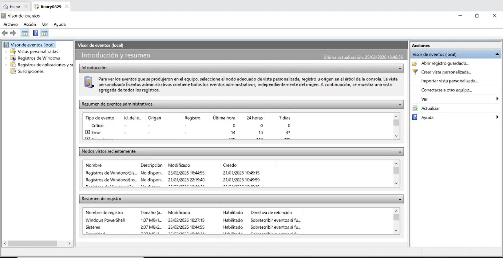


**2.** Nos dirigimos a **Registros de Windows → Sistema**.

### Evento 1074

**3.** Para buscar el primer evento, en el panel **Acciones** hacemos clic en **Filtrar registro actual...** y escribimos `1074` en el campo de identificadores.

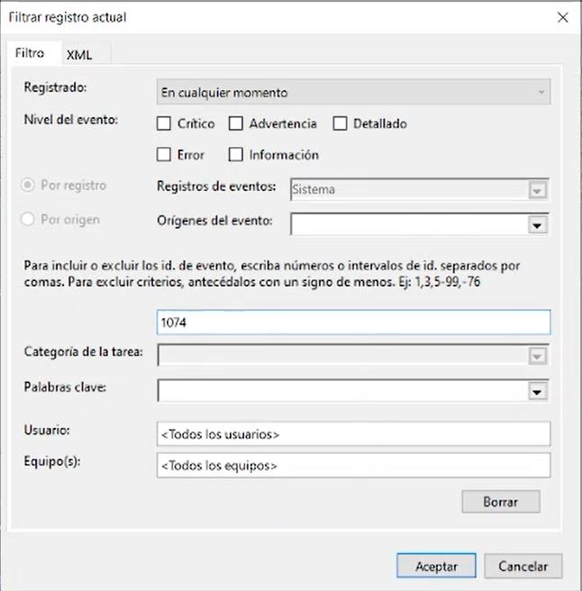


**4.** Hacemos clic en **Aceptar**. Este evento muestra los detalles de qué usuario decidió apagar el equipo.

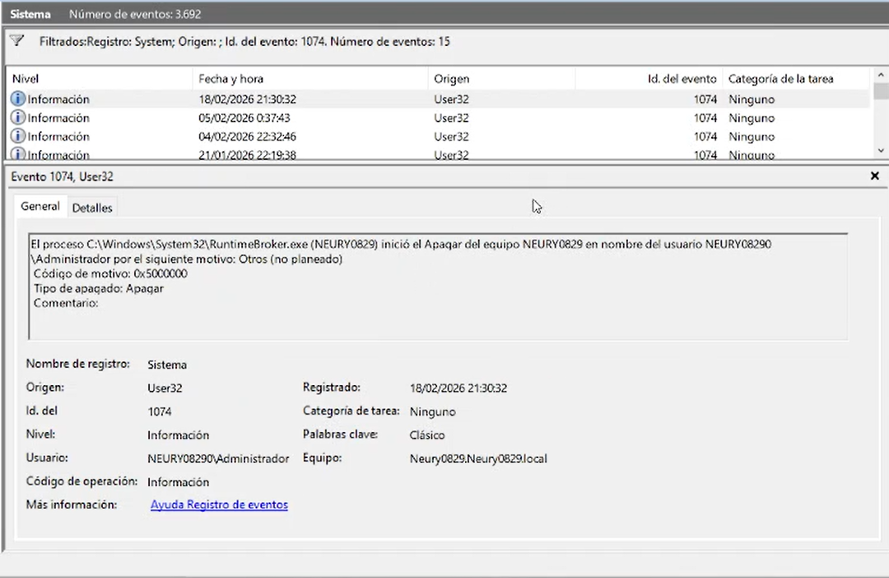


### Evento 6005

**5.** Repetimos el procedimiento con el Event ID `6005` y hacemos clic en **Aceptar**. Este evento sirve para ver los registros de inicio del servicio de Registro de eventos.

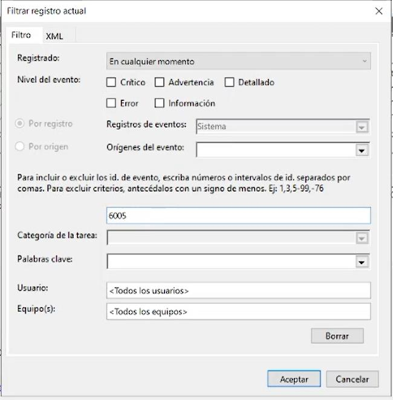

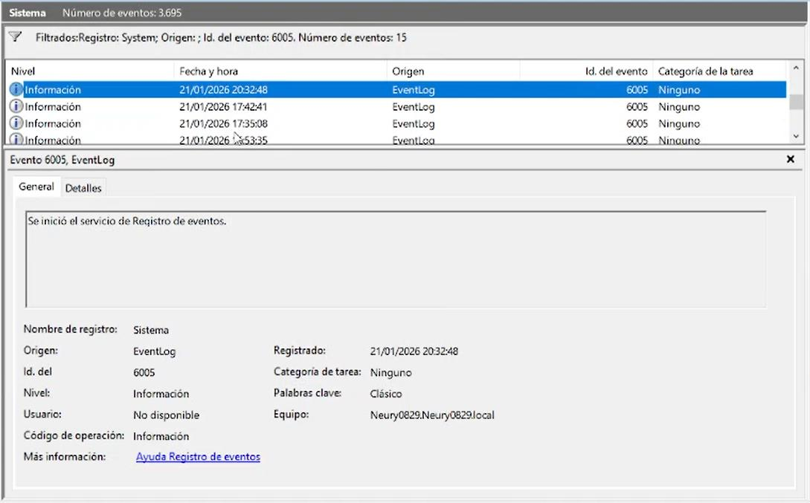


### Eventos del registro de Seguridad

**6.** Terminados los eventos del registro del Sistema, vamos al registro de **Seguridad**. Filtramos el registro actual por `4624` y hacemos clic en **Aceptar**.

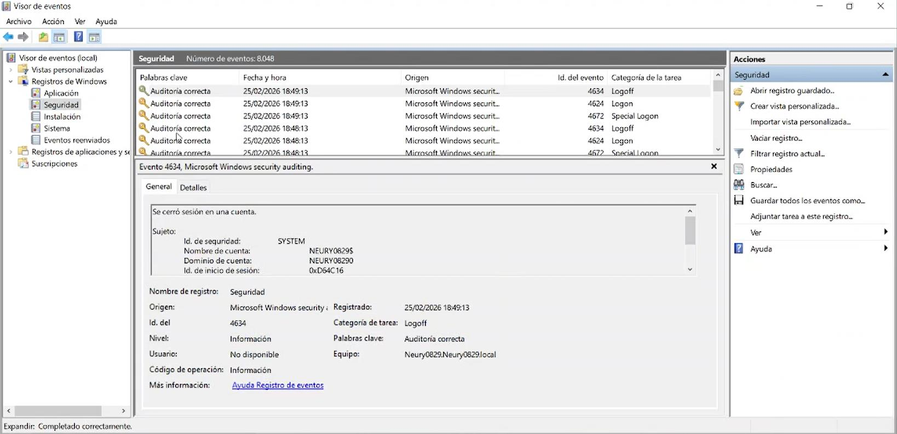

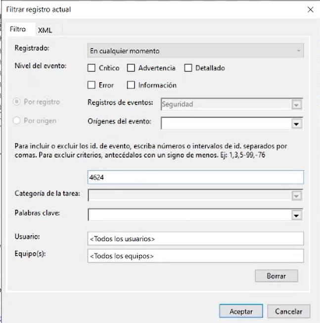


**7.** El evento **4624** sirve para auditar los inicios de sesión al sistema.


**8.** Repetimos el mismo procedimiento con el Event ID `4625`. Este evento sirve para auditar los errores de una cuenta al iniciar sesión.

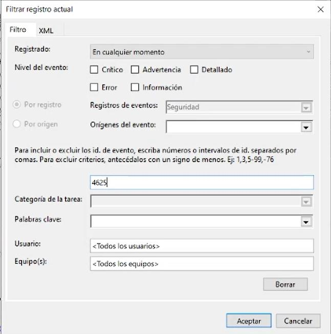


**9.** Repetimos el procedimiento con el evento `4719`.

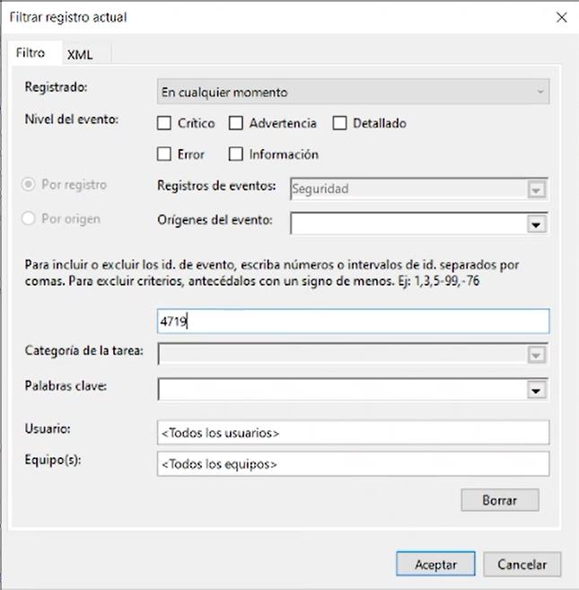

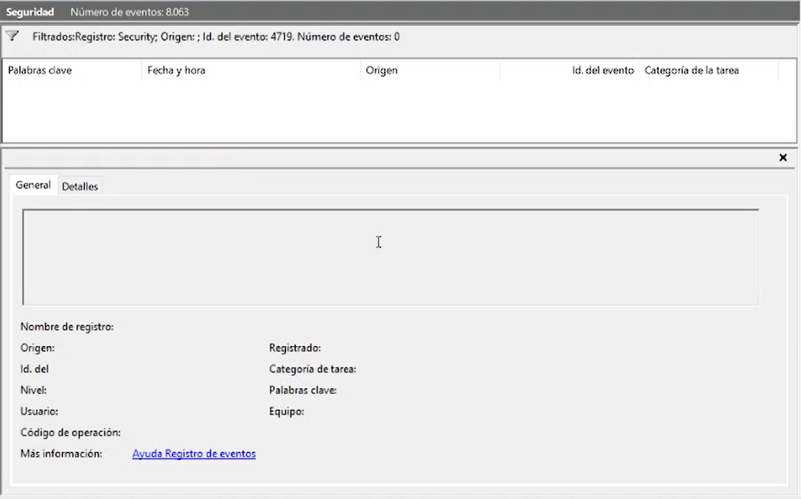


El evento **4719** indica que alguien con privilegios de administrador modificó las reglas de qué cosas debe vigilar y registrar Windows. Como esas reglas no se han modificado, no hay registros.

---

## Demostración en video

Esta práctica cuenta con una demostración en video donde se muestra el proceso completo en el laboratorio. Las capturas del procedimiento se encuentran en la carpeta `images/`.

**Video de la práctica:** [Ver demostración en YouTube](https://www.youtube.com/watch?v=rLxAmrR10vI&list=PLIJEt4hLYnOVVYlsAteeUG1azNsHhnQrb)

---

## Pasos adicionales para que LAPS funcione de extremo a extremo

Las capturas de esta práctica cubren la instalación y las directivas de contraseña. Para que LAPS (versión *legacy*) administre realmente las contraseñas del administrador local, también se requiere lo siguiente:

1. **Habilitar la directiva** *Enable local admin password management* en la GPO `LAPS`.
2. **Instalar la extensión de cliente** (*AdmPwd GPO Extension*) en los equipos que serán administrados.
3. **Extender el esquema de Active Directory** (con una cuenta de administrador de esquema), desde PowerShell en el servidor:

```powershell
Import-Module AdmPwd.PS
Update-AdmPwdADSchema
```

4. **Asignar permisos** en la OU `Empresas`: que los equipos puedan actualizar su propia contraseña y que ciertos usuarios puedan leerla.

```powershell
Set-AdmPwdComputerSelfPermission -OrgUnit "Empresas"
Set-AdmPwdReadPasswordPermission -OrgUnit "Empresas" -AllowedPrincipals "Admins. del dominio"
```

5. **Consultar la contraseña** de un equipo:

```powershell
Get-AdmPwdPassword -ComputerName WS0829
```

> [!NOTE]
> Microsoft recomienda **Windows LAPS** (integrado en el sistema operativo) para nuevos despliegues. Esta práctica utiliza Microsoft LAPS en su versión clásica, instalada con el paquete `LAPS.x64`.

---

## Lo aprendido

Esta práctica permitió trabajar la administración de contraseñas de administrador local mediante GPO: instalación de LAPS, creación de una directiva vinculada a una unidad organizativa y definición de una política de contraseñas con longitud mínima de 16 caracteres y expiración controlada.

También permitió identificar qué pasos son necesarios para que LAPS funcione de extremo a extremo: habilitar la directiva de administración, instalar la extensión de cliente, extender el esquema y asignar permisos de lectura y escritura sobre la OU.

Por otro lado, el uso del Visor de eventos permitió reconocer eventos clave de auditoría: quién apagó el equipo (1074), cuándo inició el servicio de registro (6005), los inicios de sesión correctos (4624) y fallidos (4625), y los cambios en la política de auditoría (4719). Un resultado vacío, como el del evento 4719, también es información útil: confirma que esa política no fue modificada.

## Solución de problemas frecuentes

| Problema | Causa probable | Solución |
|---|---|---|
| LAPS no cambia la contraseña del administrador local | La directiva *Enable local admin password management* no está habilitada, o el equipo no está en la OU | Habilitarla en la GPO, mover el equipo a la OU `Empresas` y ejecutar `gpupdate /force` |
| No aparecen las directivas de LAPS en la GPO | No se instalaron las plantillas | Reinstalar LAPS con *GPO Editor templates* en *Will be installed on local hard drive* |
| Error al actualizar la contraseña en AD | Falta extender el esquema o asignar permisos | Ejecutar `Update-AdmPwdADSchema` y `Set-AdmPwdComputerSelfPermission` |
| El Visor de eventos no muestra resultados | El filtro es demasiado restrictivo o el evento no ha ocurrido | Revisar el registro correcto (Sistema o Seguridad) y el Event ID; usar **Borrar** para quitar el filtro |

---

[← Volver al laboratorio](../README.md)
