# 05 - Local Administrator Password Solution (LAPS) & Event Viewer

Esta práctica documenta la implementación de LAPS para la gestión de contraseñas de administradores locales y la auditoría de eventos del sistema y seguridad en Windows Server 2022.

## A. Habilitar LAPS para la modificación de contraseñas de usuarios locales

1. Sitúate en el Escritorio luego de haber descargado previamente el archivo `LAPS.x64` desde la página oficial de Microsoft.
   
2. Haz doble clic en el archivo para abrir el asistente de instalación.
   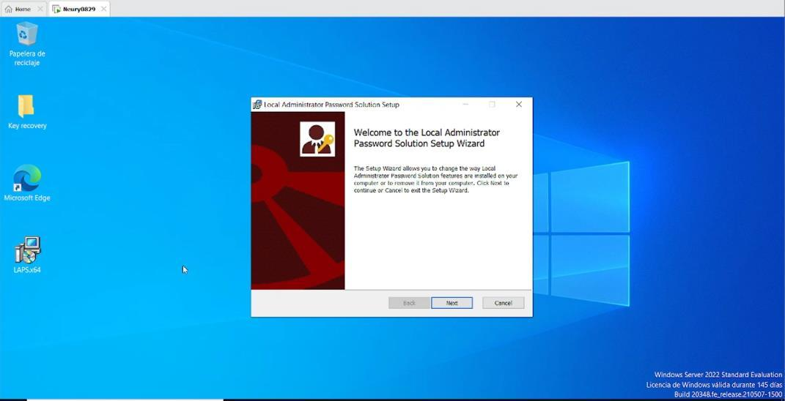
3. Haz clic en **Next** hasta llegar a la ventana de **Custom Setup**.
   
4. Configura cada uno de los parámetros (como *AdmPwd GPO Extension* y *Management Tools*) para que se instalen en el disco local. Para ello, haz clic en el icono de la "X" y cámbialo por **"Will be installed on local hard drive"**.
   
5. Haz clic en **Next** para aplicar las configuraciones y luego en **Finish** para completar la instalación.
   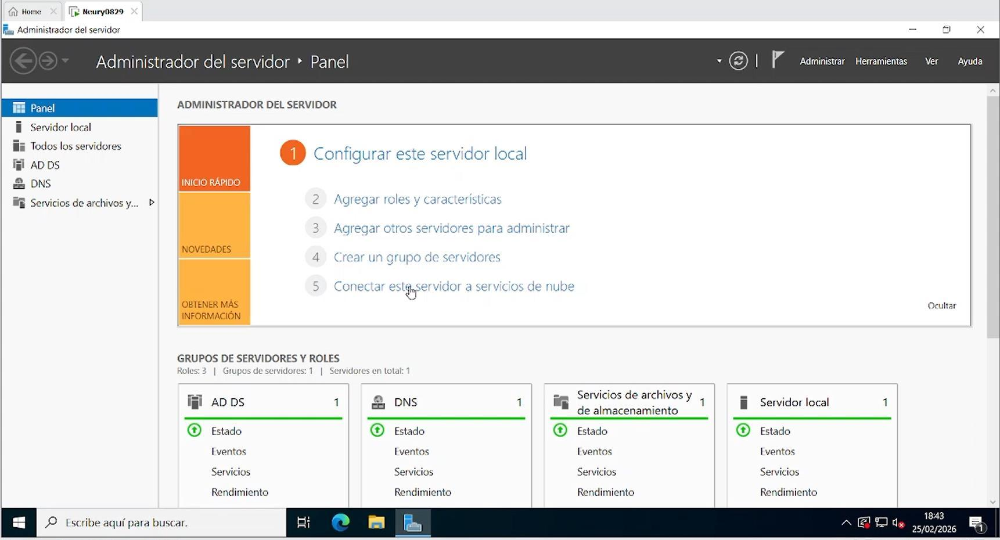

## B. Instalar y configurar LAPS mediante GPO

1. Dirígete al **Administrador del servidor**.
   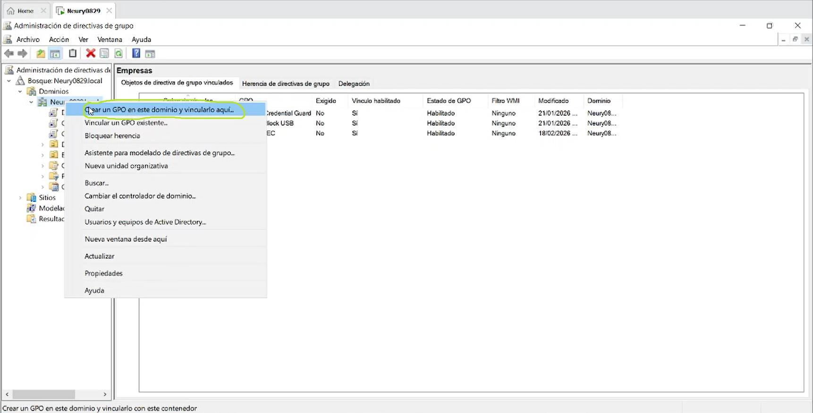
2. Haz clic en **Herramientas** y selecciona **Administración de directivas de grupo**.
   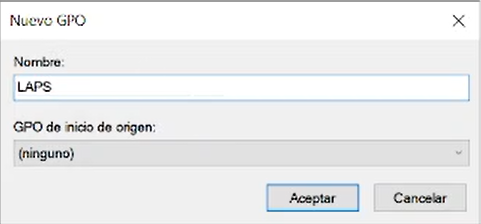
3. Crea un GPO en el dominio y vincúlalo a la unidad organizativa correspondiente (por ejemplo, "Empresas").
   
4. Establece el nombre de la directiva como **"LAPS"** y haz clic en **Aceptar**.
   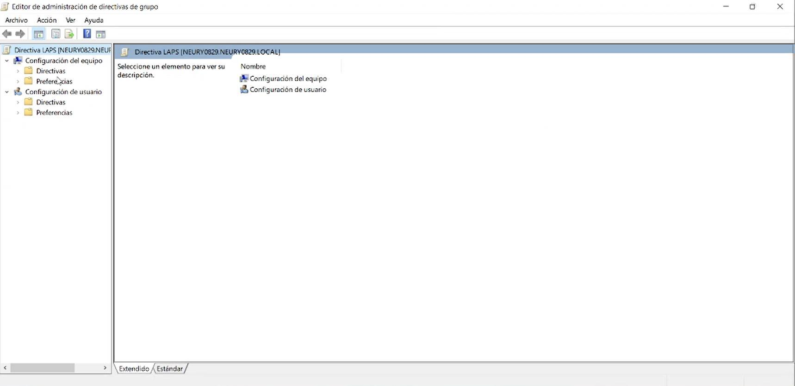
5. Haz clic derecho sobre la GPO recién creada y selecciona **Editar**.
   

## C. Garantizar contraseñas con un mínimo de 16 caracteres

1. En el **Editor de administración de directivas de grupo**, dirígete a `Configuración del equipo` > `Directivas` > `Plantillas administrativas` > `LAPS`.
   
2. Haz doble clic en la opción **Password Settings**.
   
3. Habilita la regla, deja la complejidad de la contraseña por defecto y cambia la longitud mínima (*Password Length*) de 14 a **16**. Haz clic en Aplicar y Aceptar.
   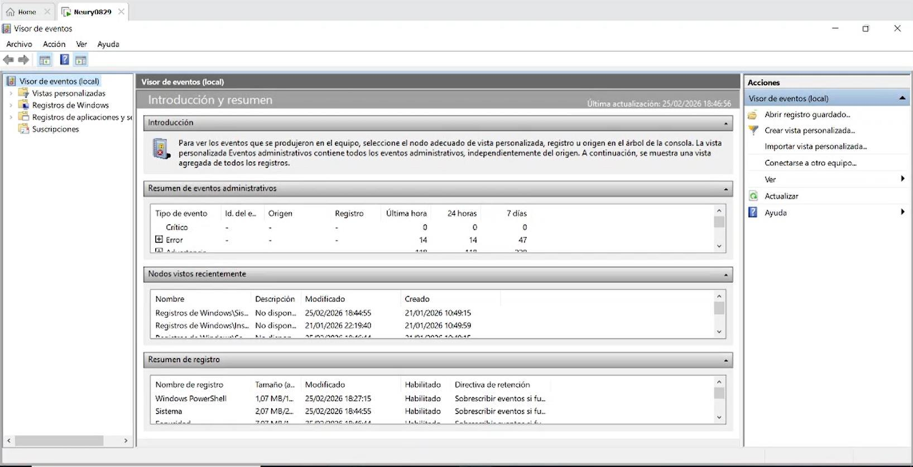
4. Abre la directiva **Do not allow password expiration time longer than required by policy** y márcala como **Habilitada**. 
   * *Nota:* Esta opción impide que una contraseña exceda su tiempo límite, forzando el cambio inmediato cuando llega su tiempo de finalización.
   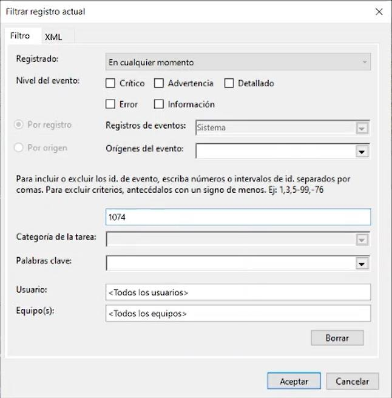
5. Haz clic en Aplicar y Aceptar.

## D. Búsqueda y análisis en el Visor de eventos

Para abrir el visor de eventos, utiliza el buscador de Windows o presiona `Win + R` y ejecuta el comando `eventvwr.msc`.
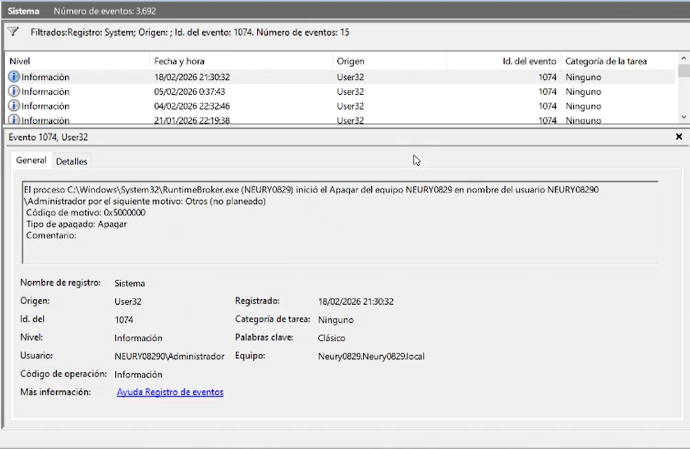

### Registros de Windows: Sistema
Navega a `Registros de Windows` > `Sistema`. En el panel de Acciones, selecciona **Filtrar registro actual...** para buscar los siguientes identificadores:

* **Event ID 1074:** Este evento muestra los detalles de qué usuario decidió apagar el equipo.
  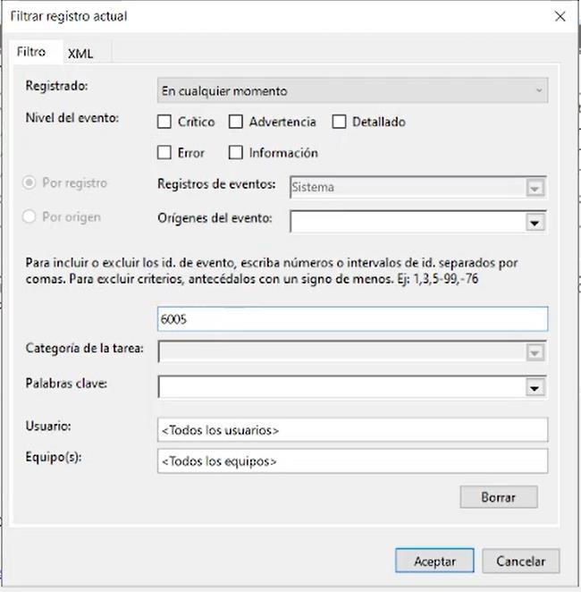
* **Event ID 6005:** Este evento sirve para ver los registros de inicios del servicio de Registro de eventos.
  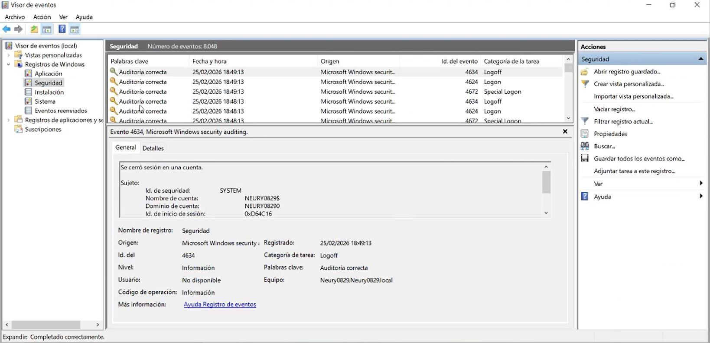

### Registros de Windows: Seguridad
Navega a `Registros de Windows` > `Seguridad` y filtra el registro actual:

* **Event ID 4624:** Sirve para hacer auditoría de los inicios de sesión exitosos al sistema.
  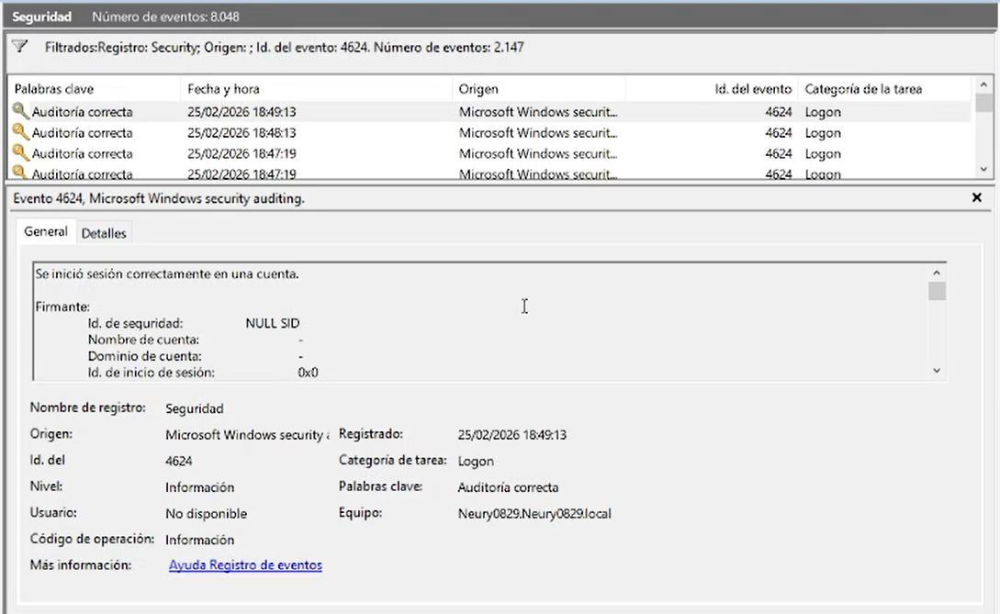
* **Event ID 4625:** Nos sirve para ver la auditoría de los errores de una cuenta al intentar iniciar sesión.
  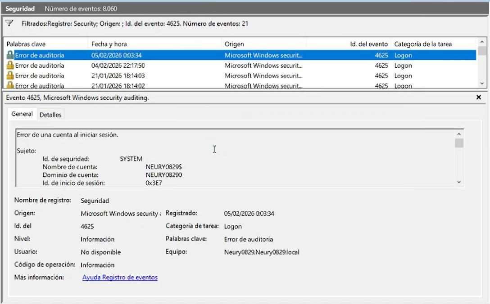
* **Event ID 4719:** Indica que alguien con privilegios de administrador modificó las reglas de qué cosas debe vigilar y registrar Windows. *(Si no hay registros bajo este ID, significa que no se han modificado dichas reglas de vigilancia)*.
  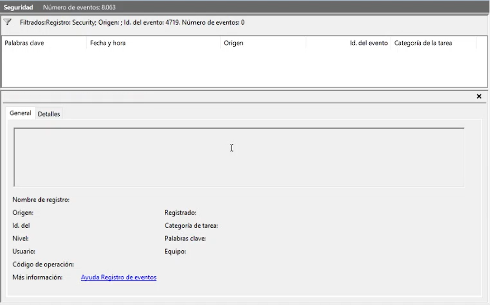
